# ResumeMatch demo run

A guided tour of the whole product in about ten minutes: set it up, upload a resume, read the analysis and
score, find the skill gaps, search and match jobs, and track applications. Every step says what to do,
what you should see (with the exact numbers) and shows a screenshot taken from this build.

The numbers below are the same on every machine, because the analysis is **rule-based**: skills are found
by matching the resume text against a fixed dictionary of 18 skills, and every score comes from a rule that
the page shows next to it.

Contents: [0 Setup](#step-0-set-up) | [1 Landing page](#step-1-the-landing-page) |
[2 Create an account](#step-2-create-an-account) | [3 Log in](#step-3-log-in) |
[4 Upload a resume](#step-4-upload-a-resume) | [5 Analysis](#step-5-resume-analysis) |
[6 Score](#step-6-resume-score) | [7 Skill gap](#step-7-skill-gap) | [8 Job search](#step-8-job-search) |
[9 Job detail](#step-9-job-detail-save-and-apply) | [10 My jobs](#step-10-my-jobs) |
[11 Dark mode and phone](#step-11-dark-mode-and-phone-layout) | [12 Log out](#step-12-log-out) |
[13 Next](#step-13-what-to-try-next)

## Step 0: Set up

### What you need
| Tool | Version |
|---|---|
| JDK | 17 or newer |
| MySQL | 8.x, running, with the `mysql` command line client |
| Apache Tomcat | 9.x, running on port 8080 |
| Jars in `lib/` | `mysql-connector-j-<version>.jar` and Tomcat's `servlet-api.jar` (see [README, Setup](README.md#setup)) |

### One command
Clone the repository, put the two jars in `lib/`, then run the setup script from the repository root.

Windows (PowerShell 5.1):
```
.\scripts\demo-setup.ps1 -ResetDb
```
Linux, macOS or Git Bash:
```
scripts/demo-setup.sh --reset-db
```

The script checks Java 17+, the `mysql` client, the jars and Tomcat's folder (`CATALINA_HOME`, default
`C:\Program Files\Apache Software Foundation\Tomcat 9.0`). It creates `src/main/resources/db.properties`
from the example file if it is missing (it asks for your MySQL user and password and never prints the
password), loads the database, runs the unit tests, builds the war, copies it into Tomcat's `webapps`,
and waits until the login page answers. It then prints the address, the demo login and the first steps.
It never starts or stops Tomcat or MySQL.

`--reset-db` / `-ResetDb` loads `database/01_schema.sql` and `02_seed_data.sql`. **That deletes every
account, resume and saved job**, so the script asks you to type `yes` first. On a fresh machine you need
it once. Run the script without the flag any time later to rebuild and redeploy only.

### Manual alternative
```
mysql -u root -p < database/01_schema.sql
mysql -u root -p < database/02_seed_data.sql
cp src/main/resources/db.properties.example src/main/resources/db.properties   # set db.user and db.password
./build.sh test deploy                                                         # Windows: build.bat test deploy
```
Then open http://localhost:8080/ResumeMatch/. Details and troubleshooting: [README](README.md#setup).

You should see: the script ends with `site is up`, the line `Passed: 186, Failed: 0` appears above it (the
test count can grow as tests are added, but Failed must be 0) and the address http://localhost:8080/ResumeMatch/.

## Step 1: The landing page
Open http://localhost:8080/ResumeMatch/.

You should see the headline "Find out which jobs your resume already fits.", a sample resume with its skills
highlighted, and a card saying **80% match** for the Java Backend Intern job (4 of 5 required skills).
The note under the buttons says the analysis is rule-based.

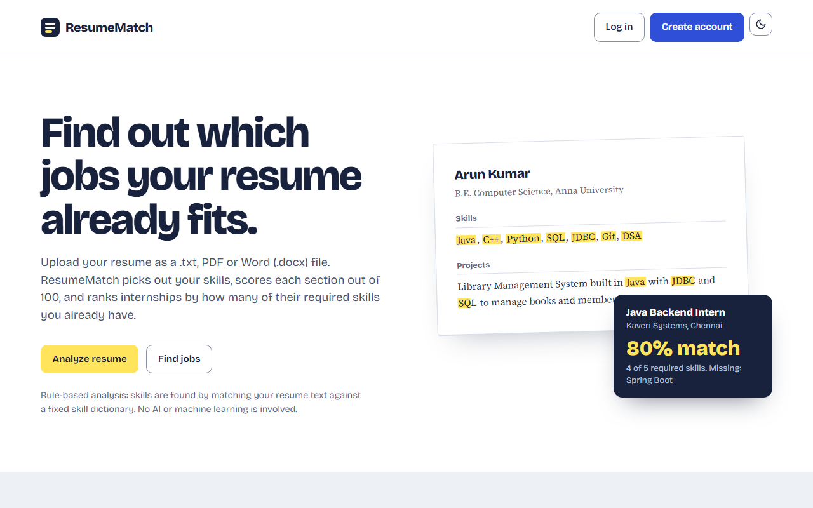

## Step 2: Create an account
Click **Create account**. Try the validation first: leave the name empty, type `arun.kumar` as the email,
`abc` as the password and `abd` as the confirmation, then press **Create account**.

You should see four messages, one under each field, and nothing is submitted:
- Enter your full name.
- Enter a valid email, like name@example.com.
- Use at least 8 characters.
- Passwords don't match.

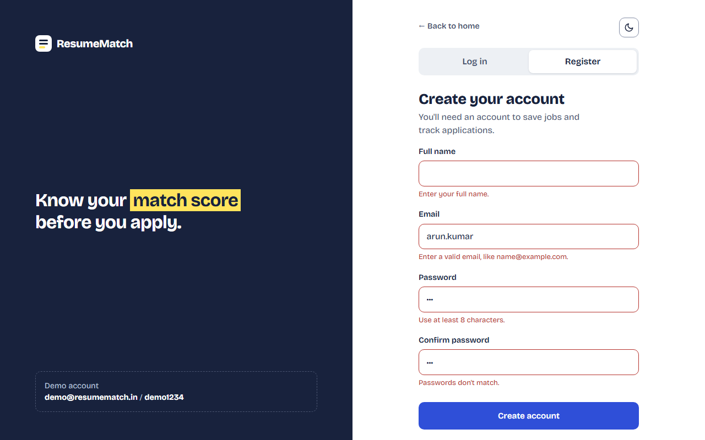

Now fill the form properly (for example `Arun Kumar`, your own email address and a password of eight or more
characters) and submit. You are sent to the login page. An email that is already registered is refused with a
friendly message instead of creating a second account.

## Step 3: Log in
After registering you land on the login page with the message **Account created. Log in to continue.** Enter
your email and password and press **Log in**.

Shortcut: the seeded demo account `demo@resumematch.in` / `demo1234` is shown on the login page. Its data is
shared by everybody who uses this database, so register your own account if you want a clean start.

You should see the dashboard greeting you by name ("Hi, Arun" in the screenshots) with the four cards
showing `—`, `—`, `—` and `0`, because no resume has been uploaded yet.

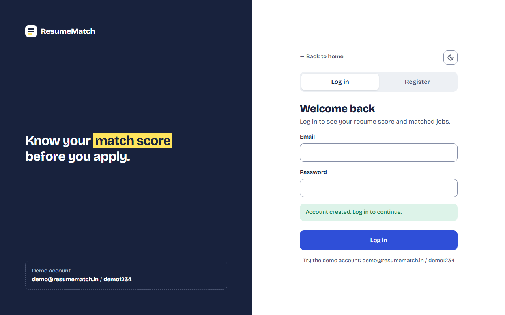

Five wrong passwords for one email lock that email for 15 minutes; the sixth try shows a "please wait" message.

## Step 4: Upload a resume
On the dashboard, press **Choose file** (or drop a file onto the dashed box) and pick
`sample-data/arun_kumar_resume.txt`.

You should see **Ready to analyze**, the file name with its size (0.8 KB) and two buttons.

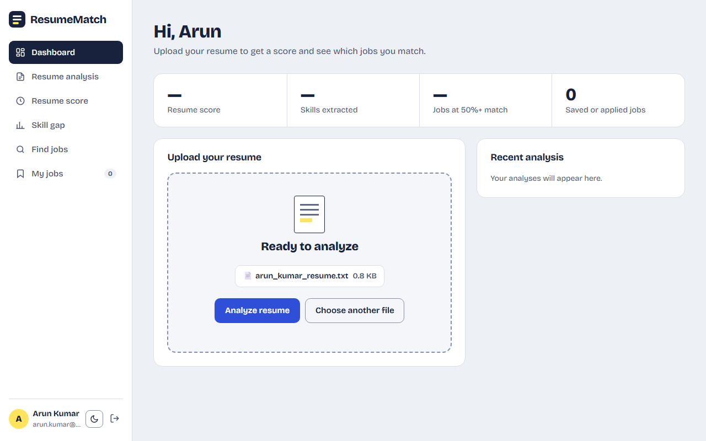

Press **Analyze resume**. The five steps run (saving the file, reading the text, matching the skill
dictionary, calculating the score, ranking jobs) and the analysis page opens. Back on the dashboard you see
**78/100**, **7** skills extracted, **5** jobs at 50%+ match, and the best matches listed:

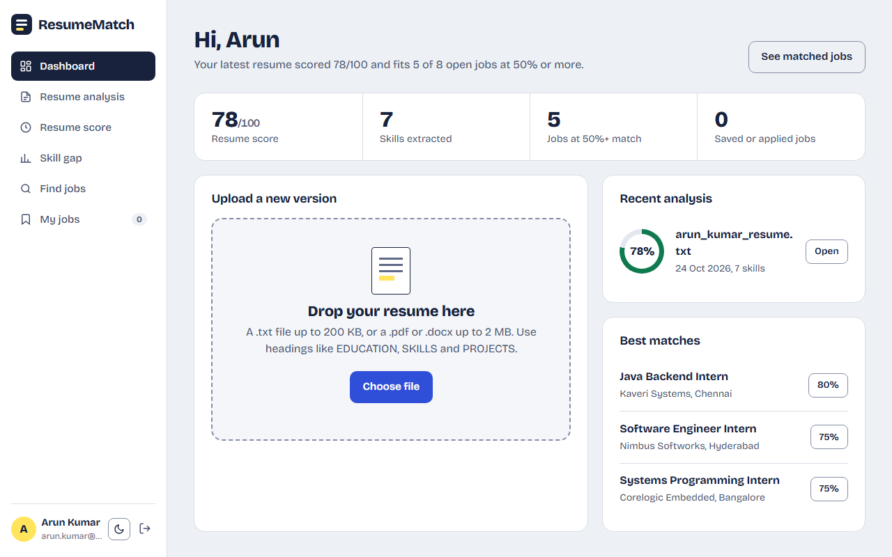

### Other formats
`.txt` (up to 200 KB), `.pdf` and Word `.docx` (up to 2 MB each) all work, using only the Java standard
library. The same resume is available in the other two formats in `test/fixtures/`:
`arun_kumar_resume.pdf` and `arun_kumar_resume.docx`. Upload either one and you get the same 7 skills and the
same 78/100.

### A file that cannot be used
Choose an old Word file such as `old_resume.doc`. Nothing is uploaded; you see:
`"old_resume.doc" can't be used. Upload a .txt, .pdf or .docx file.`

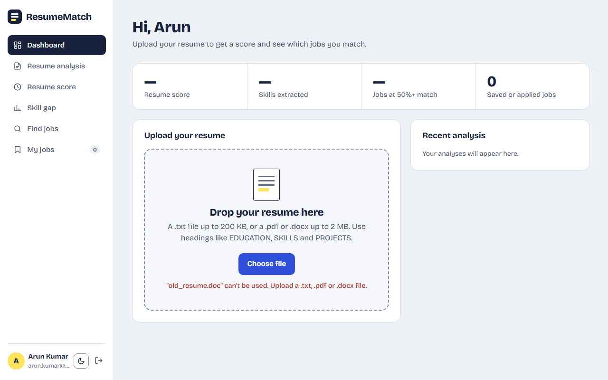

The server checks again, because the browser check can be bypassed: it looks at the file type, the size
limit, whether the file is empty, and the first bytes of PDF and Word files. A password-protected PDF, a
scanned PDF with no text, a damaged file or an oversized file each get their own plain message, and nothing is
saved.

## Step 5: Resume analysis
Open **Resume analysis** in the sidebar.

You should see **7 skills found**, grouped by category:
- Language: Java, C++, Python
- Database: SQL, JDBC
- Tool: Git
- Fundamentals: DSA

Below is the resume overview (name, education, skills, projects, certifications, experience taken from the
section headings) and the full resume text with every matched word highlighted. A skill counts once, however
often it appears. **Download resume** returns the file you uploaded.


## Step 6: Resume score
Open **Resume score**.

You should see **78/100** and one line per rule, each saying how its points were earned:

| Section | Points | Rule shown on the page |
|---|---|---|
| Skills | 32 / 40 | 7 skills x 4.5 points (full marks at 9 skills) |
| Projects | 16 / 20 | 2 projects x 8 points, max 16; +4 for measurable results (not found) |
| Education | 13 / 15 | Degree found (+10); CGPA 8.2 listed (+3) |
| Certifications | 7 / 10 | 2 certifications x 3.5 points |
| Experience | 10 / 15 | 1 internship/job entry x 10 points, max 15 |

32 + 16 + 13 + 7 + 10 = **78**. The right-hand column lists the strengths (for example "Good Java knowledge,
including database access with JDBC") and the areas to improve (add Spring Boot or REST APIs, add
measurable project results such as "cut load time by 30%", learn a deployment tool like Docker).

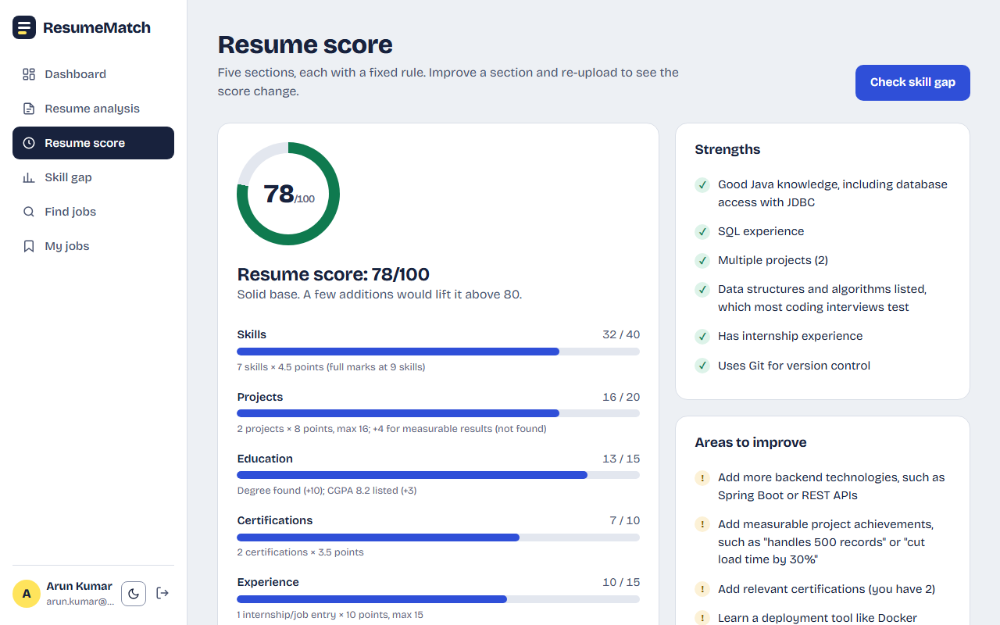

## Step 7: Skill gap
Press **Check skill gap**, or open **Skill gap** in the sidebar. The target job is **Java Backend Intern,
Kaveri Systems**; use the drop-down to compare against any other job.

You should see **Skill match: 67%**: you have 4 of the 6 skills listed for the job (required and preferred
together), so 4 / 6 = 67%.
- Matched: Java, SQL, JDBC, Git (all required)
- Missing: Spring Boot (required) and REST API (preferred)

The note under the figure explains why this differs from the 80% job match: the job match counts required
skills only. **Recommended skills to learn** ranks the skills missing across all 8 jobs: Spring Boot (2
jobs), Docker (2 jobs), Linux (1 job), REST API (2 jobs) and Flask (1 job). Skills needed by jobs you nearly
match come first, so those are the best next things to learn.

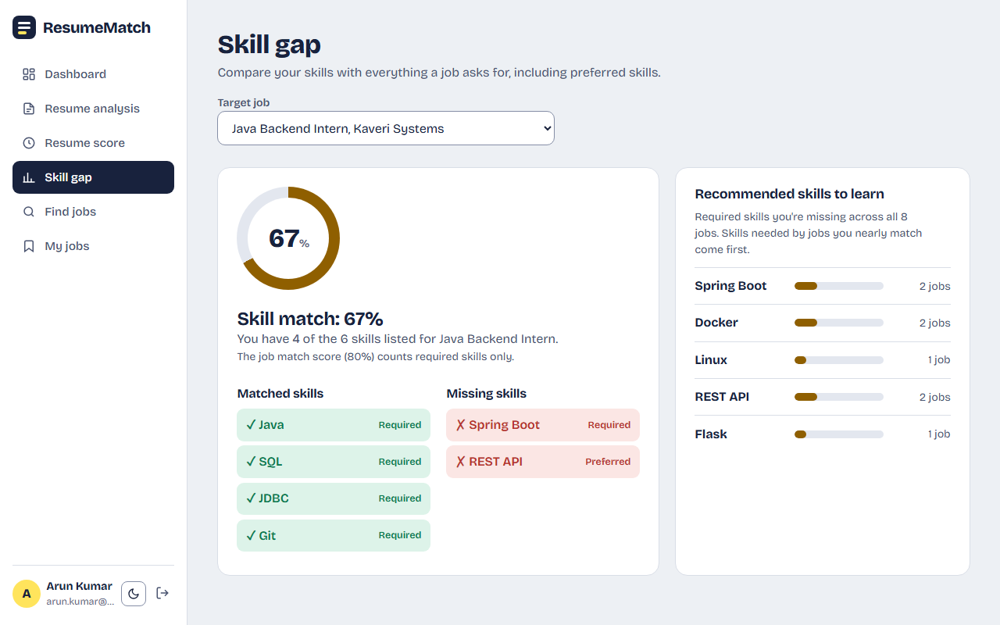

## Step 8: Job search
Open **Find jobs** and search for `Java`.

You should see **4 jobs for "Java", best match first**:

| Job | Company | Match |
|---|---|---|
| Java Backend Intern | Kaveri Systems | 80% |
| Software Engineer Intern | Nimbus Softworks | 75% |
| Junior Java Developer | Coromandel FinTech | 40% |
| Full Stack Intern | Stackline Technologies | 33% |

Each card lists the required skills with a tick for the ones you have and a cross for the ones you lack.


Narrow the list with the **Location**, **Job type** and **Experience level** drop-downs, or with the
**Minimum match** slider (it moves in steps of 10). With the slider at 50% the list shrinks to the **two** jobs
at 50% or more, 80% and 75%. **Clear filters** brings everything back.

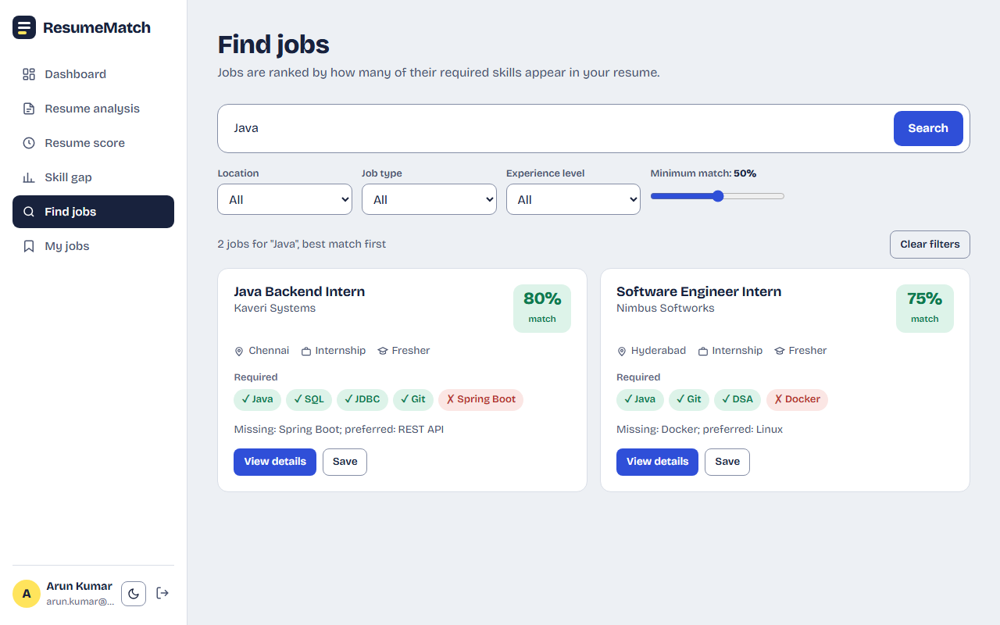

## Step 9: Job detail, save and apply
Press **View details** on Java Backend Intern.

You should see the match worked out in plain arithmetic:
```
matched required = 4
total required   = 5
4 / 5 x 100 = 80% match
```
Java, SQL, JDBC and Git are ticked; Spring Boot is missing, and REST API is a missing preferred skill (it
does not change the percentage).


Press **Save job**. The button turns green and reads **Saved**.

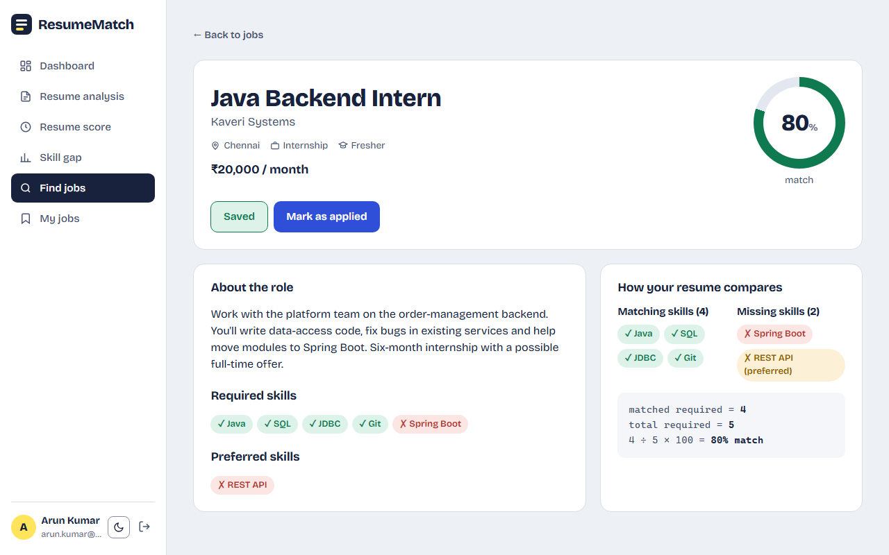

Press **Mark as applied**. You are taken to **My jobs**, on the Applied tab, where the job now has the status
Applied. Opening the job again shows **Applied** on a disabled button.

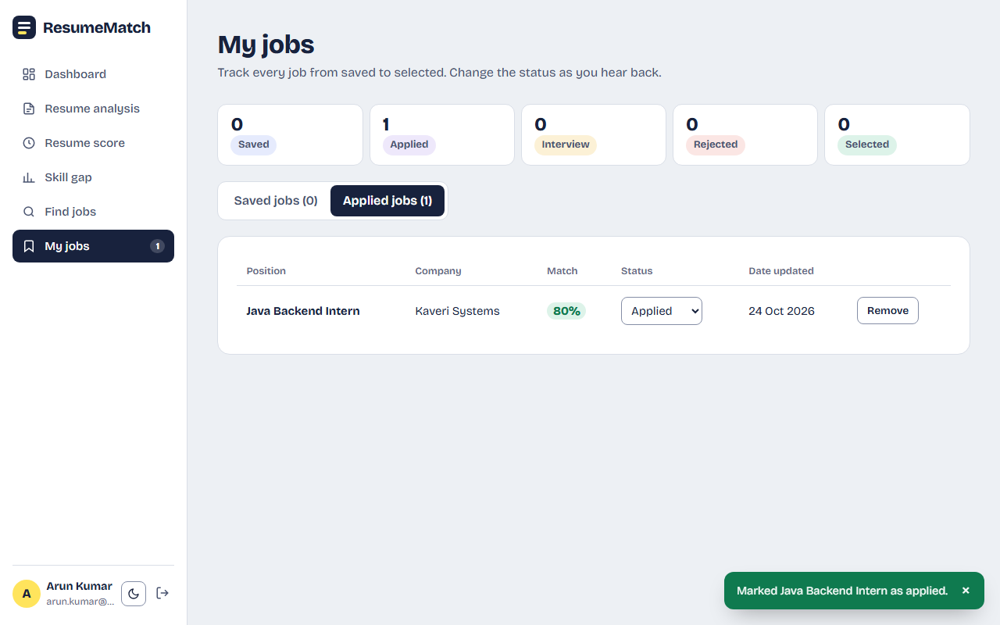

For the next step also save two more jobs: Python Developer Intern (67%) and Junior Java Developer (40%).

## Step 10: My jobs
Open **My jobs**. The five counters at the top (Saved, Applied, Interview, Rejected, Selected) add up your
tracked jobs, and the **Saved jobs** and **Applied jobs** tabs list them.

You should see **Saved jobs (2)** with Junior Java Developer (40%) and Python Developer Intern (67%), each
with **Mark as applied** and **Remove**, and **Applied jobs (1)** with Java Backend Intern (80%).

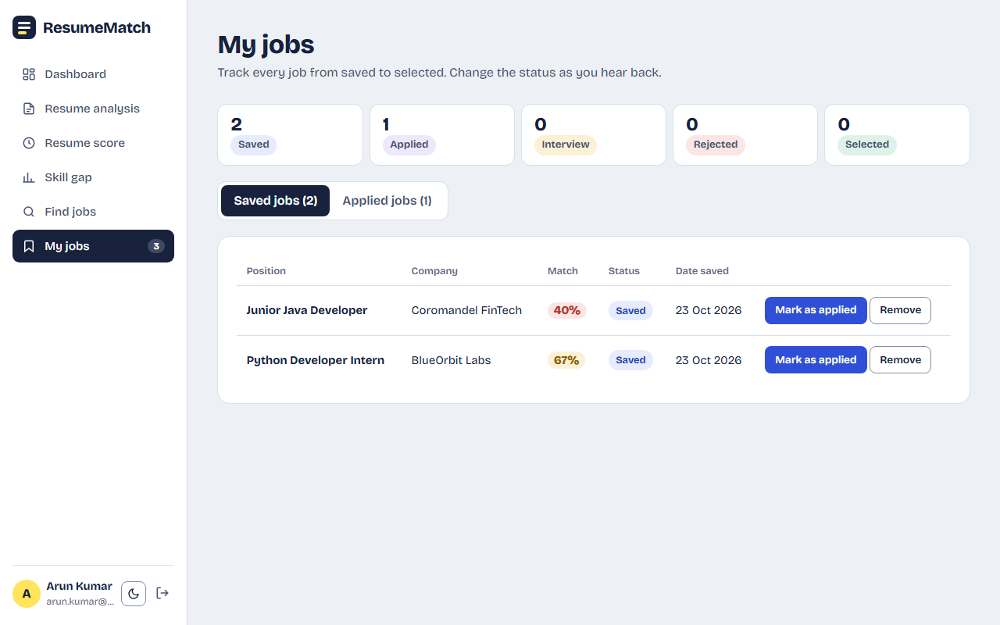

**Change a status.** On the Applied tab, change the drop-down for Java Backend Intern from Applied to
Interview. A message says **Status changed to Interview.** and the counters update (Applied 0, Interview 1).

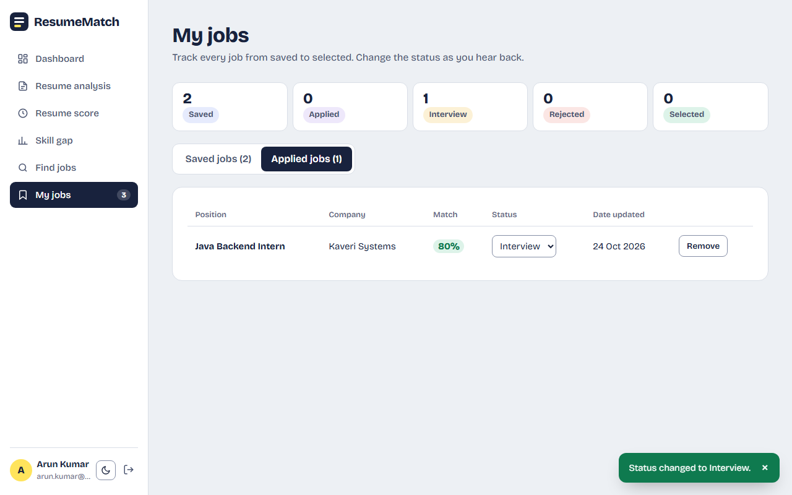

**Remove a job.** On the Saved tab press **Remove** next to Junior Java Developer and confirm. A message says
**Removed from My jobs.** and only Python Developer Intern is left.

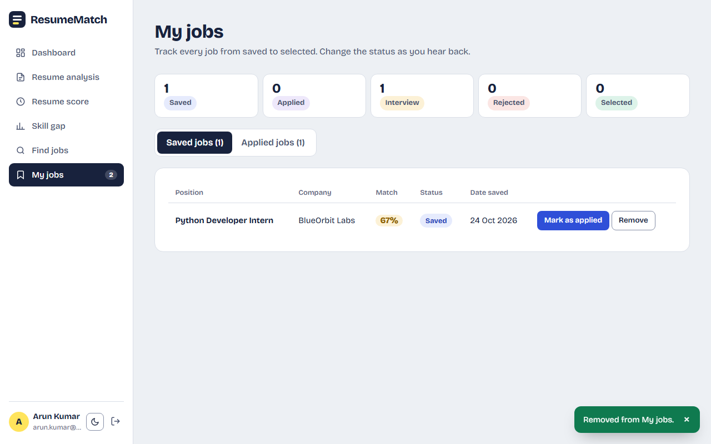

## Step 11: Dark mode and phone layout
The round button in the sidebar (top right on the login and landing pages) switches between the light and
dark theme. The choice is remembered, and the first visit follows your system setting. It works with the
keyboard (Tab to it, then Enter or Space).

You should see the same 78/100 page in dark colours:

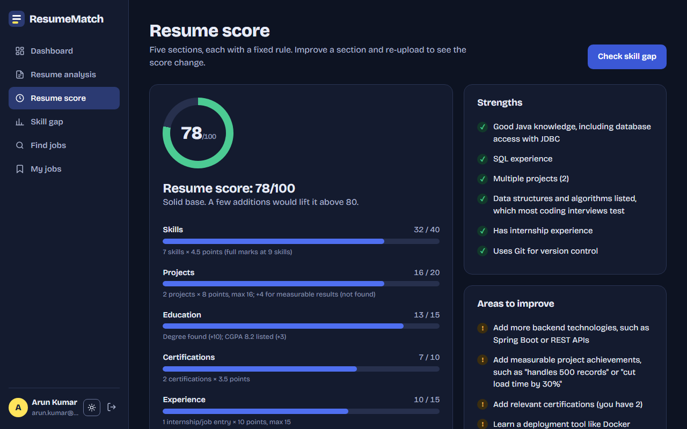

Make the browser window narrower than 760 pixels (or open the site on a phone). The sidebar becomes a top bar
with a scrolling menu, the filters stack, and every page stays usable without sideways scrolling.

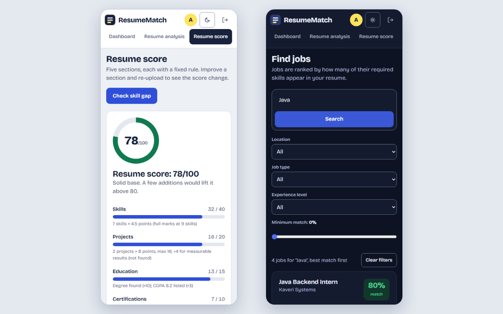

## Step 12: Log out
Press the log out icon at the bottom of the sidebar.

You should see the login page with the message **You have been logged out.** Opening any inside page (for
example `/dashboard`) now sends you back to the login page.


## Step 13: What to try next
- **Compare two resumes.** Log in again, upload `sample-data/priya_sharma_resume.txt` and open **Resume
  score**. It scores **75/100**: Skills 23/40 (5 skills), Projects 20/20 (3 projects, with measurable results
  found), Education 15/15 (degree +10, CGPA 8.7 gives +5), Certifications 7/10 and Experience 10/15. Fewer
  skills, better projects and education. The newest upload is the one all pages use.

  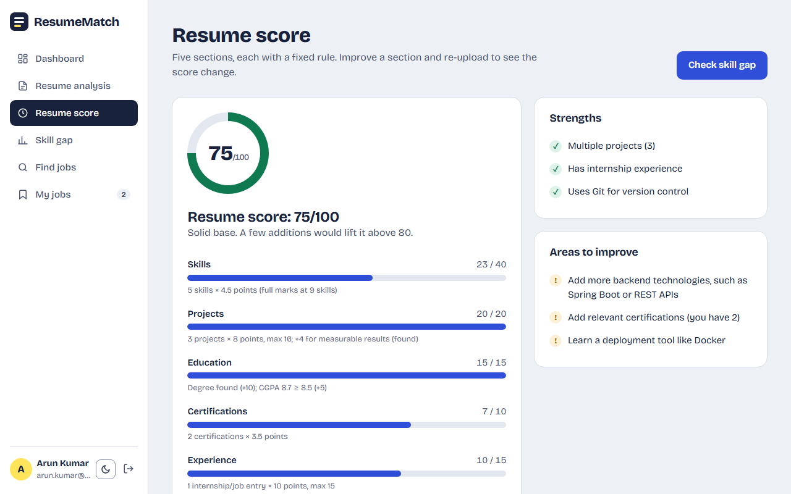
- **Improve a score.** Copy a sample resume, add Spring Boot and REST API to its SKILLS section and a measurable
  result to a project (for example "cut load time by 30%"), upload it and watch the score and the job
  matches change.
- **Check every flow automatically.** `scripts/smoke-test.sh` (or `scripts/smoke-test.ps1`) registers a
  throw-away user, walks through all pages including bad uploads, and removes what it created.
- **Run the analysis without a server.** See "Run the analysis without a server" in the [README](README.md#usage-walkthrough).

### Troubleshooting
If a page does not load, the login says the database cannot be reached, or the script stops early, see the
[Troubleshooting table in the README](README.md#troubleshooting). The most common causes are a missing MySQL
jar in Tomcat's `lib` folder, a wrong password in `db.properties`, and Tomcat not running on port 8080.
