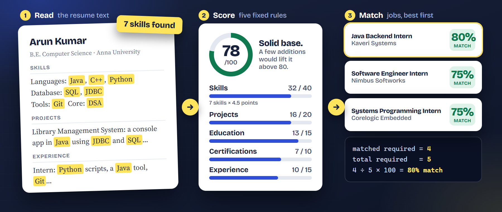
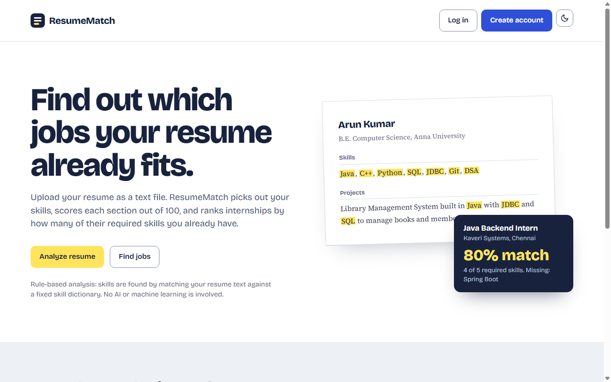
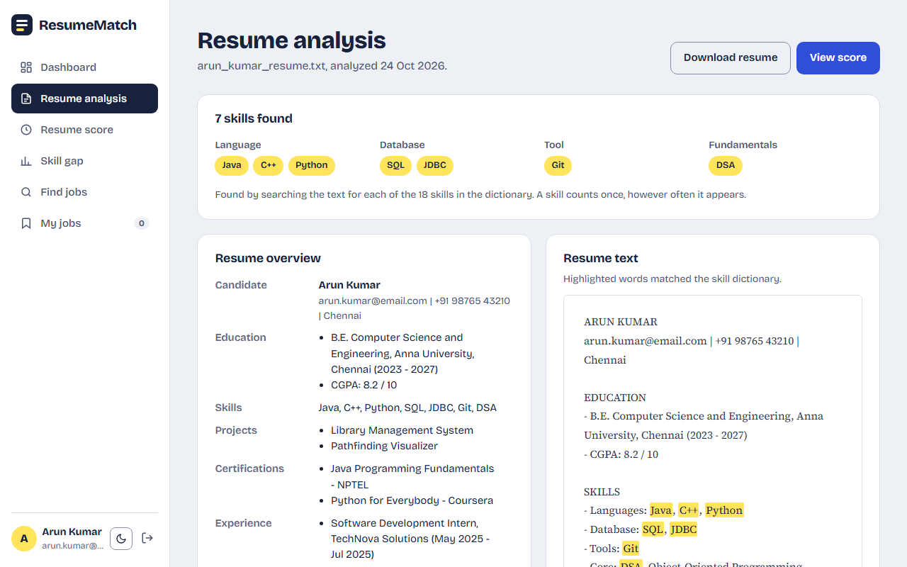
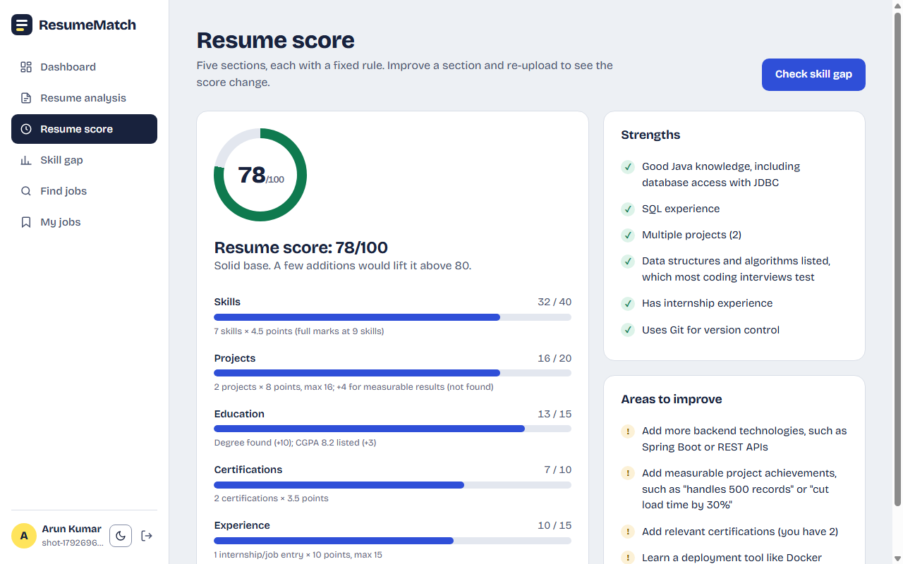
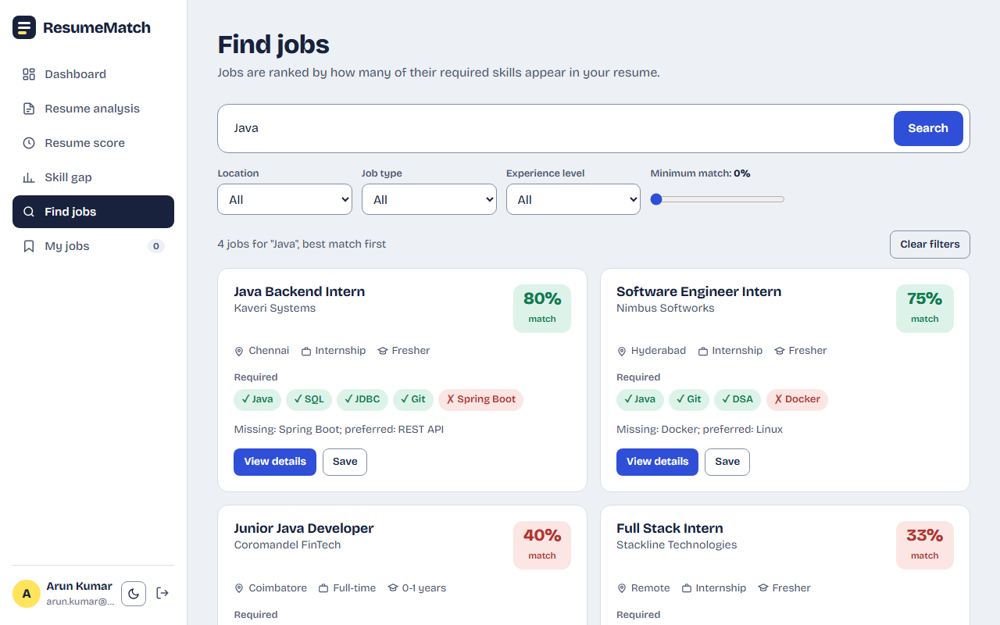
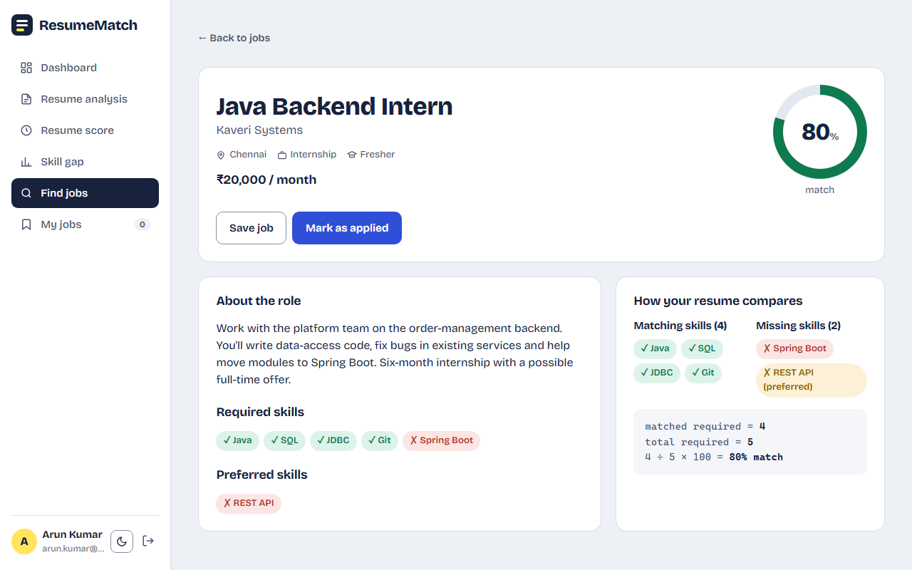
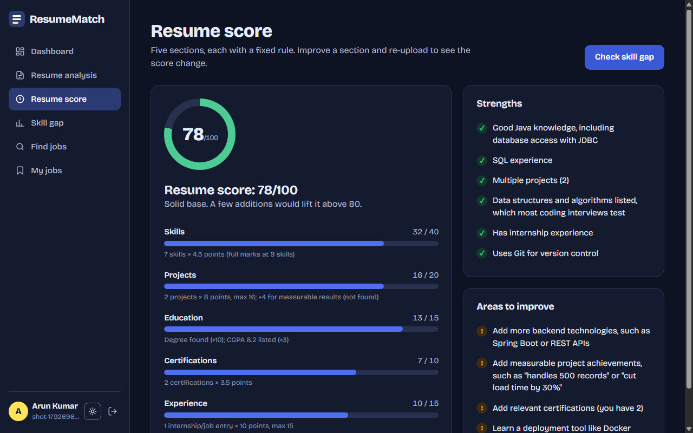
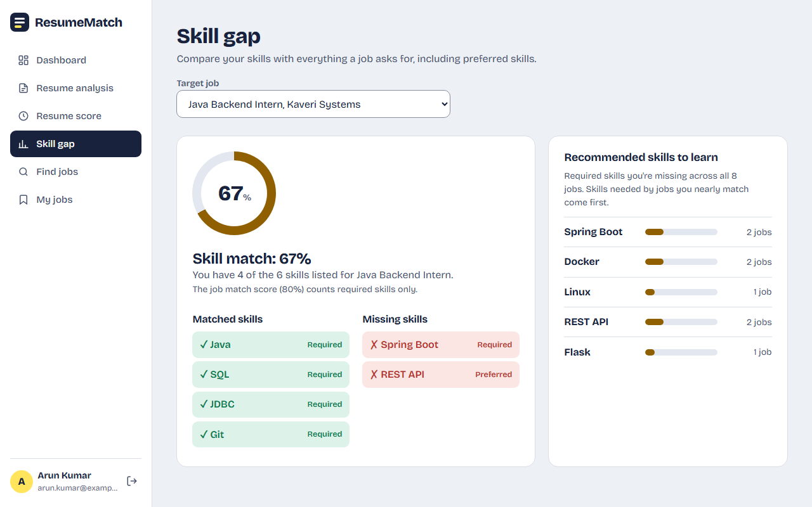
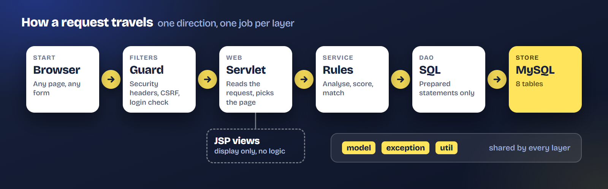

<div align="center">


# ResumeMatch

**Know what your resume says.**<br>
Upload a resume, see which skills it shows, get a score out of 100 and find the jobs it already fits. Every number comes with the rule behind it.

[](https://adoptium.net/)
[](https://tomcat.apache.org/download-90.cgi)
[](https://dev.mysql.com/downloads/mysql/)
[](lib/README.md)
[](https://github.com/Barathkumar-17/ResumeMatch/actions/workflows/ci.yml)
[](LICENSE)

[Run it in one command](#try-the-demo) &nbsp;·&nbsp; [One resume, start to finish](#one-resume-start-to-finish) &nbsp;·&nbsp; [How it works](#how-it-works) &nbsp;·&nbsp; [Code tour](#code-tour-where-to-look)

<br>



<sub>After the demo setup, log in with <code>demo@resumematch.in</code> / <code>demo1234</code>. Want to show it to others? See <a href="DEPLOY.md">Share a live demo</a>.</sub>

</div>

> [!NOTE]
> The analysis is **rule-based**. Skills are found by matching the resume text against a fixed skill dictionary stored in the database. There is no AI or machine learning, so every number on screen can be explained by a rule shown next to it.

> [!TIP]
> Reviewing this project? [How it works](#how-it-works) explains the rules, the [code tour](#code-tour-where-to-look) maps each Java concept to its source file, and [Database schema](#database-schema) lists the tables and their relationships.

## Contents

**What you get** &nbsp;·&nbsp; [What it does](#what-it-does) · [One resume, start to finish](#one-resume-start-to-finish) · [Features](#features) · [Screens](#screens)

**Run it** &nbsp;·&nbsp; [Try the demo](#try-the-demo) · [Quick start](#quick-start) · [Take the tour](#take-the-tour) · [Setup and configuration](#setup-and-configuration) · [Troubleshooting](#troubleshooting) · [Backup and restore](#backup-and-restore) · [Share a live demo](DEPLOY.md)

**Under the hood** &nbsp;·&nbsp; [How it works](#how-it-works) · [Architecture](#architecture) · [Database schema](#database-schema) · [Code tour](#code-tour-where-to-look) · [Security](#security) · [Testing](#testing) · [Project layout](#project-layout)

**About** &nbsp;·&nbsp; [Team](#team) · [License](#license)

## What it does
You upload a resume. ResumeMatch then:

1. finds the **skills** written in it (Java, SQL, Git and so on),
2. gives the resume a **score out of 100** and shows the reason for every point,
3. shows the **skills you are missing** for a job you pick,
4. **ranks job openings** by how many of their required skills you already have.

## One resume, start to finish
The sample resume [`sample-data/arun_kumar_resume.txt`](sample-data/arun_kumar_resume.txt) goes in and this comes
out. Every row follows a rule written down in [How it works](#how-it-works), so you can check the numbers by hand.

| Step | What happens | Result for the sample |
|---|---|---|
| **1. Read** | The text is searched for each of the 18 skills in the dictionary | 7 skills: Java, C++, Python, SQL, JDBC, Git, DSA |
| **2. Score** | Five fixed rules add up | 32 + 16 + 13 + 7 + 10 = **78/100** |
| **3. Match** | Required skills the resume has ÷ required skills of the job | Java Backend Intern: 4 ÷ 5 = **80%** |
| **4. Gap** | The same job, counting required and preferred skills | 4 of 6 = **67%**; missing Spring Boot and REST API |

## Features
| Area | What you get |
| --- | --- |
| **Accounts** | Register and log in. Salted PBKDF2 password hashes, session-based access control and a sign-in attempt limit. |
| **Upload** | `.txt` (up to 200 KB), `.pdf` or `.docx` (up to 2 MB) with type, size, encoding and empty-file validation. Old binary `.doc` files are not supported, and a password-protected or scanned PDF gets a friendly message instead of a result. |
| **Skills** | Skill extraction grouped by category, with the skills highlighted in the resume text. |
| **Score** | A five-part score (skills, projects, education, certifications, experience) with the reason for every rule. |
| **Job search** | Keyword, location, type and experience filters and a minimum-match slider. |
| **Job detail** | Shows the match calculation, e.g. 4 of 5 required skills = 80%. |
| **Skill gap** | Gap analysis against a chosen job, with the skills most worth learning next. |
| **Saved and applied** | Save jobs, mark them as applied (the job then shows "Applied") and track status: Applied, Interview, Rejected, Selected. |
| **Look and feel** | Light and dark theme, phone-width layout, keyboard accessible. |

## Screens
<p align="center">
  
  
  <br><sub><b>Landing.</b> Log in or create an account. &nbsp;&nbsp;|&nbsp;&nbsp; <b>Dashboard.</b> Upload, score, best matches.</sub>
</p>

<p align="center">
  
  
  <br><sub><b>Analysis.</b> 7 skills, highlighted in the text. &nbsp;&nbsp;|&nbsp;&nbsp; <b>Score.</b> 78/100, a rule behind every point.</sub>
</p>

<p align="center">
  
  
  <br><sub><b>Job search.</b> Filters and a minimum-match slider. &nbsp;&nbsp;|&nbsp;&nbsp; <b>Job detail.</b> 4 of 5 required skills = 80%.</sub>
</p>

<p align="center">
  
  
  <br><sub><b>Dark theme.</b> One click in the sidebar. &nbsp;&nbsp;|&nbsp;&nbsp; <b>Skill gap.</b> 67% for one job, what to learn next.</sub>
</p>

More pictures, full size: [SCREENSHOTS.md](SCREENSHOTS.md).

## Try the demo
One command sets everything up. It checks your tools, creates `db.properties`, runs the unit tests, builds
and deploys the app, and waits until the site answers. It never starts or stops Tomcat or MySQL.
```
scripts/demo-setup.sh --reset-db                                            # Linux, macOS, Git Bash
powershell -ExecutionPolicy Bypass -File scripts\demo-setup.ps1 -ResetDb    # Windows PowerShell
```
(`-ExecutionPolicy Bypass` lets Windows run a script that is not signed; it applies to this one command
only.) Tomcat and MySQL must already be running and `lib/` must hold the two jars (see the
[Quick start](#quick-start), steps 1 to 3). On Linux and macOS first set `CATALINA_HOME`
to your Tomcat folder, for example `export CATALINA_HOME=$HOME/apache-tomcat-9.0.123`; on Windows the
default is `C:\Program Files\Apache Software Foundation\Tomcat 9.0`.

Run it without the flag to just rebuild and redeploy. Then log in with `demo@resumematch.in` / `demo1234`.

**Share a live demo.** To let other people try the running app over the internet, `scripts/public-demo.ps1` /
`scripts/public-demo.sh` open a free temporary https address to your PC. See [DEPLOY.md](DEPLOY.md).

> **Warning:** `--reset-db` / `-ResetDb` reloads the database and **deletes all accounts and resumes**,
> so the script asks for confirmation first.

## Quick start
Never set up a Java web app before? Follow these steps in order. Each one says what it does and how to
check that it worked. (Want it done for you? Use the [demo setup script](#try-the-demo).)

1. **Install the tools.** You need four things:
   - **Git** (to download the code). Get it from https://git-scm.com/downloads. On Windows it also gives
     you *Git Bash*, a terminal that understands the `./build.sh` commands below.
   - **JDK 17 or newer** (the Java Development Kit: compiler and runtime). Get it from
     https://adoptium.net/ (Temurin 17 or 21).
   - **MySQL Community Server 8.x** (the database). Get it from https://dev.mysql.com/downloads/mysql/.
     Make sure the server is running and you know the password of its `root` user.
   - **Apache Tomcat 9** (the web server that runs the app). Download the *Core* `zip` (Windows) or
     `tar.gz` (Linux, macOS) from https://tomcat.apache.org/download-90.cgi and unpack it anywhere. Use
     version 9, not 10: this project uses `javax.servlet`. This README calls that folder `<tomcat>`.

   *Check:* `git --version` works, `java -version` and `javac -version` print 17 or higher (you need a
   JDK, not only a JRE), and `mysql --version` prints 8.x.

2. **Get the code.**
   ```
   git clone https://github.com/Barathkumar-17/ResumeMatch.git
   cd ResumeMatch
   ```
3. **Get the two jars** and put both in the `lib/` folder (create it if it is missing). A jar is a
   packaged Java library. The project needs only these two:
   - `mysql-connector-j-<version>.jar` from https://dev.mysql.com/downloads/connector/j/
     (choose *Platform Independent*). It lets Java talk to MySQL.
   - `servlet-api.jar`, found in `<tomcat>/lib/`. It lets the code compile against Tomcat.

   Also copy the MySQL jar into `<tomcat>/lib/` (Tomcat needs the driver at run time too). The jars are
   not committed to the repository.

   *Check:* `lib/` holds exactly two `.jar` files.

4. **Load the database.** These two scripts create the `resumematch` database, 18 skills, 8 jobs and a
   demo user. Run them from the project folder; MySQL asks for the `root` password each time:
   ```
   mysql -u root -p -e "source database/01_schema.sql"
   mysql -u root -p -e "source database/02_seed_data.sql"
   ```
   (`mysql -u root -p < database/01_schema.sql` does the same in Bash and `cmd`, but not in PowerShell.)
   If `mysql` is "not recognized" on Windows, add `C:\Program Files\MySQL\MySQL Server 8.0\bin` to your
   `PATH` or call it with the full path.

   *Check:* `mysql -u root -p -e "SELECT COUNT(*) FROM resumematch.jobs"` prints 8.

5. **Tell the app how to reach the database.** Copy the example settings file, then open the copy and set
   `db.user` and `db.password` to your MySQL login:
   ```
   cp src/main/resources/db.properties.example src/main/resources/db.properties
   ```
   (On Windows `cmd` or PowerShell use `copy src\main\resources\db.properties.example src\main\resources\db.properties`.)
   This file stays on your machine and is not committed.

6. **Build and deploy.** This compiles the code, packs `build/ResumeMatch.war` (a *war* is a web
   application packed into one file) and copies it into Tomcat's `webapps` folder. First tell the script
   where Tomcat is by setting `CATALINA_HOME`. On Windows the default is
   `C:\Program Files\Apache Software Foundation\Tomcat 9.0`, so skip this if you installed it there:
   ```
   export CATALINA_HOME=$HOME/apache-tomcat-9.0.123      # Linux, macOS, Git Bash: your Tomcat folder
   ./build.sh deploy
   ```
   ```
   set CATALINA_HOME=C:\tools\apache-tomcat-9.0.123      & rem Windows cmd: your Tomcat folder
   build.bat deploy
   ```
   (In PowerShell use `$env:CATALINA_HOME = "C:\tools\apache-tomcat-9.0.123"` and `.\build.bat deploy`.)

   Then start Tomcat if it is not running yet: `<tomcat>/bin/startup.sh` (Linux, macOS) or
   `<tomcat>\bin\startup.bat` (Windows). Tomcat notices a new war by itself, so later rebuilds need no
   restart.

   *Check:* the script ends without errors and `webapps/ResumeMatch/` appears in Tomcat after a few seconds.

7. **Open the app.** Go to http://localhost:8080/ResumeMatch/ and log in with `demo@resumematch.in` /
   `demo1234`, or register your own account. Upload `sample-data/arun_kumar_resume.txt`.

   *Check:* the dashboard shows **78/100** and **7 skills**.

> **Tip:** if something goes wrong, the [Troubleshooting](#troubleshooting) table lists the common
> messages and their fixes. The app log is `<tomcat>/logs/resumematch.0.log`.

## Take the tour
New here? [DEMO.md](DEMO.md) is a guided tour of about ten minutes. Every step has a screenshot and the
exact numbers you should see: create an account, upload a resume (78/100), read the skill gap (67%),
search jobs (80, 75, 40, 33), save and apply, then try dark mode and the phone layout.

## Setup and configuration
The [beginner steps](#quick-start) above are all you need to get running. This section
adds the detail.

<details>
<summary><b>Show prerequisites, notes and the configuration table</b></summary>

### Prerequisites
| Tool | Version | Needed for |
|---|---|---|
| JDK | 17 or newer | building and running |
| MySQL | 8.x | the database |
| Apache Tomcat | 9.x (`javax.servlet`) | running the web app |
| MySQL Connector/J | `mysql-connector-j-<version>.jar` | the JDBC driver |
| bash + curl, or PowerShell 5.1 | any | the smoke test (optional) |

### Notes on the steps
- **Database scripts can be run again.** The schema script drops and recreates the database, and the seed
  script clears the seeded tables before inserting. **Running either again deletes all accounts and resumes.**
- **Build.** `build.bat` on Windows, `./build.sh` elsewhere, produces `build/ResumeMatch.war`.
- **Deploy.** `build.bat deploy` (or `./build.sh deploy`) builds the war and copies it into
  `%CATALINA_HOME%\webapps` (`$CATALINA_HOME/webapps` in Bash). If `CATALINA_HOME` is not set the default is
  `C:\Program Files\Apache Software Foundation\Tomcat 9.0`, so on Linux and macOS you must set it. The
  script never stops or starts Tomcat or any other service.

### Configuration
| Setting | Where | Default |
|---|---|---|
| Database URL, user, password | `db.properties` keys `db.url`, `db.user`, `db.password`, or the environment variables `RESUMEMATCH_DB_URL`, `RESUMEMATCH_DB_USER`, `RESUMEMATCH_DB_PASSWORD` (these win) | `jdbc:mysql://localhost:3306/resumematch`, `root`, empty |
| Database timeouts | added to the URL automatically unless it already sets them | connect 5 s, socket 30 s |
| Resume folder | context parameter `resumeDir` in `WEB-INF/web.xml` | `<tomcat>/resumes/user_<id>/` |
| Tomcat folder for `deploy` and the demo script | environment variable `CATALINA_HOME` | `C:\Program Files\Apache Software Foundation\Tomcat 9.0` |
| Application log | `java.util.logging`, set up at startup | `<tomcat>/logs/resumematch.0.log` (1 MB × 5 files, rotated) |
| Session timeout | `WEB-INF/web.xml` | 30 minutes |
| Total storage for resumes | context parameter `maxResumeStorageMb` in `WEB-INF/web.xml`, or the environment variable `RESUMEMATCH_MAX_STORAGE_MB` (wins); when all stored resumes together would pass it, uploads are refused with a friendly message | 200 MB |
| Resumes kept per user | fixed in `ResumeDAO.MAX_RESUMES_PER_USER`; saving a sixth resume deletes the oldest row and its file | 5 |
| Live-demo mode (pauses new sign-ups) | environment variable `RESUMEMATCH_DEMO_MODE=true`, context parameter `demoMode`, or the flag file `<tomcat>/resumematch-demo-mode.flag` (checked every 10 s; the share scripts create and remove it) | off |

To use another resume folder, add this to `WEB-INF/web.xml`:
```xml
<context-param>
  <param-name>resumeDir</param-name>
  <param-value>C:/resumematch-uploads</param-value>
</context-param>
```

</details>

## Troubleshooting
<details>
<summary><b>Common messages and fixes (15)</b></summary>

| Problem | Fix |
|---|---|
| `ClassNotFoundException: com.mysql.cj.jdbc.Driver` in the log | The MySQL jar is missing from `<tomcat>/lib/`. Copy it there and restart Tomcat. |
| "Can't reach the database right now" | MySQL is not running, or `db.user` / `db.password` are wrong. Check `<tomcat>/logs/resumematch.0.log`, fix `db.properties` and rebuild. |
| `Access denied for user 'root'` in the log | The password in `db.properties` does not match your MySQL password. |
| "This form expired" (403) after submitting a form | The session timed out or the page was open in an old tab. Reload the page and submit again. |
| "Too many failed sign-in attempts" | Wait for the time shown, or restart Tomcat to clear the in-memory counters. |
| `Tomcat webapps folder not found` when deploying | `CATALINA_HOME` is not set (or points to the wrong folder). Set it to your Tomcat 9 folder, see step 6. |
| Build says `servlet-api.jar is missing` | Copy `servlet-api.jar` from `<tomcat>/lib/` into `lib/`. |
| `build.sh` fails with `$'\r': command not found` | The script was checked out with Windows line endings. Run `git add --renormalize . && git checkout -- build.sh`. |
| PowerShell says running scripts is disabled | Run the script as `powershell -ExecutionPolicy Bypass -File scripts\demo-setup.ps1`. |
| `mysql` or `mysqldump` is "not recognized" / "command not found" | Add MySQL's `bin` folder to your `PATH`, or call it with the full path. |
| Port 8080 already in use | Stop the other program, or change the connector port in `<tomcat>/conf/server.xml`. |
| `package javax.servlet does not exist` or `jakarta` errors | This project targets Tomcat 9 (`javax.servlet`). Tomcat 10 and later use `jakarta.servlet`. |
| "password-protected" or "scanned image" message for a PDF | Text cannot be read from encrypted PDFs or scans. Export a text-based PDF, or upload a `.txt` or `.docx` copy. Old `.doc` files must be saved as `.docx` first. |
| Upload fails or downloads return 404 | Make sure Tomcat can write to `<tomcat>/resumes/`, or set the `resumeDir` parameter shown above. |
| Dates are a few hours off | Remove any `serverTimezone` setting from `db.url`; the driver detects the server time zone itself. |
| Smoke test cannot clean up | Put the `mysql` client on the PATH (or set `MYSQL`) and set `MYSQL_PWD`. |

</details>

## Backup and restore
<details>
<summary><b>Show the backup and restore commands</b></summary>

Back up the database and the resume folder together, because each resume row points to a file:
```
mysqldump -u root -p --single-transaction --result-file=resumematch-backup.sql resumematch
```
and copy `<tomcat>/resumes/`. To restore:
```
mysql -u root -p -e "CREATE DATABASE IF NOT EXISTS resumematch CHARACTER SET utf8mb4 COLLATE utf8mb4_unicode_ci"
mysql -u root -p resumematch -e "source resumematch-backup.sql"
```
then put the resume folder back in the same place.

</details>

## How it works
Everything is deterministic and rule-based: the same resume always gives the same result.

**Sections.** The resume is read line by line. A line that holds only a heading such as `EDUCATION` (any letter case, optional colon), `SKILLS`,
`PROJECTS`, `CERTIFICATIONS` or `EXPERIENCE` (a few alternatives such as `INTERNSHIPS` are accepted)
starts a section. Lines starting with `-`, `•` or `*` are the items; a section without any such line uses its non-empty lines.

**Skill detection.** Every skill in the dictionary (name plus aliases) is searched for in the whole
text, ignoring case. A match must not sit inside a longer word, and `+` and `#` count as word
characters, so `C++` is found and `Java` does not match `JavaScript`. A skill counts once however
often it appears.

**Resume score (100 points).** `s` is the number of skills, `p` the project bullets, `c` the
certification bullets and `e` the experience bullets.

| Rule | Points | Calculation |
|---|---|---|
| Skills | 40 | `min(40, round(s × 4.5))`, full marks at 9 skills |
| Projects | 20 | `min(16, p × 8)`, plus 4 if the projects or experience mention measurable results (a number with `%`, users, records, requests, ms and similar) |
| Education | 15 | 10 for a degree (B.E., B.Tech, M.Tech, B.Sc, BCA, MCA ...), plus 5 for a CGPA of 8.5 or more or 3 for a lower listed CGPA |
| Certifications | 10 | `min(10, round(c × 3.5))` |
| Experience | 15 | `min(15, e × 10)` |

**Worked example.** The sample resume `sample-data/arun_kumar_resume.txt` earns
32 (skills) + 16 (projects) + 13 (education) + 7 (certifications) + 10 (experience) = **78/100**.
The score page also lists strengths and areas to improve.

**Job match.** Only required skills count; preferred skills never change the score.
```
match % = round(required skills the resume has × 100 / required skills of the job)
```
Jobs are sorted by match, then by title. The sample resume against the Java Backend Intern job has
4 of its 5 required skills, so 4 ÷ 5 × 100 = **80%**.

**Skill gap.** The gap page counts required plus preferred skills, so the same job shows
4 of 6 = **67%**. The job match counts required skills only (80%) and the page says so. The
recommended skills are the required skills missing across all jobs, weighted by how close the
resume already is to each job, top five shown.

<details>
<summary><b>Run the analysis without a server</b></summary>

This prints the skills, the score breakdown and the ranked job
list for the sample resume (it needs the database for the skill dictionary and jobs). Add a file path
at the end to analyse another `.txt` resume, for example `sample-data/priya_sharma_resume.txt` (75/100).
```
javac --release 17 -cp "lib/*" -d build/classes $(find src/main/java -name '*.java')
java -cp "build/classes:src/main/resources:lib/*" com.resumematch.console.ConsoleDemo
```
On Windows (`cmd`) use a source list file and `;` in the classpath:
```
mkdir build
dir /s /b src\main\java\*.java > build\sources.txt
javac --release 17 -cp "lib\*" -d build\classes @build\sources.txt
java -cp "build\classes;src\main\resources;lib\*" com.resumematch.console.ConsoleDemo
```

</details>

## Architecture
<p align="center"></p>

- `model`: plain objects passed between layers (`User`, `Resume`, `Skill`, `Job`, `JobMatch`, ...)
- `exception`: custom exceptions with user-friendly messages; no stack trace ever reaches the browser
- `util`: JDBC connection, password hashing, sign-in attempt limit, input validation, HTML escaping
- `dao`: all SQL, using `PreparedStatement` only; the resume save is one transaction
- `service`: file reading and storage, resume analysis, scoring and job matching
  (`ResumeReader` and `JobMatcher` interfaces with their implementations)
- `web`: servlets, filters and the startup listener that sets up logging
- `console`: `ConsoleDemo`, which runs the whole analysis pipeline without a server

### Tech stack
Built with Java 17 · OOP · JDBC · MySQL 8 · Java file handling · Collections · exception handling ·
Servlets and JSP (Tomcat 9, `javax.servlet`) · HTML · CSS · JavaScript.
No frameworks, no ORM and no build tool: the project compiles with plain `javac`. The only jars are
MySQL Connector/J and Tomcat's servlet API. Fonts (Bricolage Grotesque and Source Serif 4, SIL Open Font
License) are bundled, so pages work offline.

## Database schema
Eight tables, created by [`database/01_schema.sql`](database/01_schema.sql) and filled with starter
data (18 skills, 8 jobs, one demo user) by [`database/02_seed_data.sql`](database/02_seed_data.sql).

| Table | What it stores | Keys and relationships |
|---|---|---|
| `users` | registered accounts; the password column holds a salted PBKDF2 hash, never plain text | `id` PK; `email` UNIQUE |
| `resumes` | every uploaded resume: file name and path, extracted text, score | `id` PK; `user_id` FK -> `users.id` (ON DELETE CASCADE) |
| `skills` | the skill dictionary used for text matching, with aliases for other spellings | `id` PK; `skill_name` UNIQUE |
| `resume_skills` | which skills were found in which resume (many-to-many) | (`resume_id`, `skill_id`) composite PK; FKs to `resumes` and `skills` |
| `jobs` | job and internship listings | `id` PK; `job_type` ENUM('Internship','Full-time','Part-time') |
| `job_skills` | the skills each job asks for, marked REQUIRED or PREFERRED; only REQUIRED skills count toward the match % | (`job_id`, `skill_id`) composite PK; FKs to `jobs` and `skills` |
| `saved_jobs` | jobs a user bookmarked | (`user_id`, `job_id`) composite PK; FKs to `users` and `jobs` |
| `applications` | jobs a user applied to, with status (Applied, Interview, Rejected, Selected) | `id` PK; UNIQUE(`user_id`, `job_id`), so one application per user per job |

Relationships at a glance. Many-to-many links get their own table with a composite primary key,
so skills are queried and compared without parsing comma-separated strings:
```
users  1 -- *  resumes  * -- *  skills   (through resume_skills)
jobs   * -- *  skills             (through job_skills, REQUIRED or PREFERRED)
users  * -- *  jobs               (through saved_jobs and applications)
```

<details>
<summary>Full CREATE TABLE definitions (copied from <code>database/01_schema.sql</code>)</summary>

```sql
-- =====================================================================
-- ResumeMatch - database schema
-- Drops and recreates the whole database, so it is safe to run again.
--
-- Run:  mysql -u root -p < database/01_schema.sql
-- Then: mysql -u root -p < database/02_seed_data.sql
-- =====================================================================

DROP DATABASE IF EXISTS resumematch;
CREATE DATABASE resumematch
    CHARACTER SET utf8mb4
    COLLATE utf8mb4_unicode_ci;

USE resumematch;

-- ---------------------------------------------------------------------
-- users: one row per registered user.
-- The UNIQUE index on email is what makes a second sign-up with the same
-- email fail (SQLIntegrityConstraintViolationException in JDBC).
-- password holds a salted PBKDF2 hash (pbkdf2$iterations$salt$hash), never plain text.
-- ---------------------------------------------------------------------
CREATE TABLE users (
    id          INT AUTO_INCREMENT PRIMARY KEY,
    name        VARCHAR(100) NOT NULL,
    email       VARCHAR(150) NOT NULL,
    password    VARCHAR(255) NOT NULL,
    created_at  TIMESTAMP    NOT NULL DEFAULT CURRENT_TIMESTAMP,
    CONSTRAINT uq_users_email UNIQUE (email)
) ENGINE=InnoDB DEFAULT CHARSET=utf8mb4 COLLATE=utf8mb4_unicode_ci;

-- ---------------------------------------------------------------------
-- resumes: every uploaded resume (.txt, .pdf or .docx). file_path is where the file was
-- saved on disk, resume_text is the full text, score is out of 100.
-- ---------------------------------------------------------------------
CREATE TABLE resumes (
    id           INT AUTO_INCREMENT PRIMARY KEY,
    user_id      INT          NOT NULL,
    file_name    VARCHAR(255) NOT NULL,
    file_path    VARCHAR(500) NOT NULL,
    resume_text  MEDIUMTEXT   NOT NULL,
    score        INT          NOT NULL DEFAULT 0,
    uploaded_at  TIMESTAMP    NOT NULL DEFAULT CURRENT_TIMESTAMP,
    CONSTRAINT fk_resumes_user
        FOREIGN KEY (user_id) REFERENCES users(id) ON DELETE CASCADE,
    -- "latest resume of a user" is ORDER BY uploaded_at DESC for one user_id
    INDEX idx_resumes_user_uploaded (user_id, uploaded_at)
) ENGINE=InnoDB DEFAULT CHARSET=utf8mb4 COLLATE=utf8mb4_unicode_ci;

-- ---------------------------------------------------------------------
-- skills: the skill dictionary used for text matching.
-- aliases is a comma separated list of other spellings (e.g. "CPP").
-- ---------------------------------------------------------------------
CREATE TABLE skills (
    id          INT AUTO_INCREMENT PRIMARY KEY,
    skill_name  VARCHAR(50)  NOT NULL,
    category    VARCHAR(30)  NOT NULL,
    aliases     VARCHAR(200) NULL,
    CONSTRAINT uq_skills_name UNIQUE (skill_name)
) ENGINE=InnoDB DEFAULT CHARSET=utf8mb4 COLLATE=utf8mb4_unicode_ci;

-- ---------------------------------------------------------------------
-- resume_skills: which skills were found in which resume (many-to-many).
-- ---------------------------------------------------------------------
CREATE TABLE resume_skills (
    resume_id  INT NOT NULL,
    skill_id   INT NOT NULL,
    PRIMARY KEY (resume_id, skill_id),
    CONSTRAINT fk_resume_skills_resume
        FOREIGN KEY (resume_id) REFERENCES resumes(id) ON DELETE CASCADE,
    CONSTRAINT fk_resume_skills_skill
        FOREIGN KEY (skill_id) REFERENCES skills(id)
) ENGINE=InnoDB DEFAULT CHARSET=utf8mb4 COLLATE=utf8mb4_unicode_ci;

-- ---------------------------------------------------------------------
-- jobs: job and internship listings shown on the search page.
-- ---------------------------------------------------------------------
CREATE TABLE jobs (
    id           INT AUTO_INCREMENT PRIMARY KEY,
    title        VARCHAR(120) NOT NULL,
    company      VARCHAR(120) NOT NULL,
    location     VARCHAR(80),
    job_type     ENUM('Internship','Full-time','Part-time'),
    experience   VARCHAR(40),
    description  TEXT,
    salary       VARCHAR(50),
    posted_at    TIMESTAMP    NOT NULL DEFAULT CURRENT_TIMESTAMP
) ENGINE=InnoDB DEFAULT CHARSET=utf8mb4 COLLATE=utf8mb4_unicode_ci;

-- ---------------------------------------------------------------------
-- job_skills: skills each job asks for.
-- Only REQUIRED rows count towards the match score; PREFERRED rows are
-- shown as "nice to have" and on the skill gap page.
-- ---------------------------------------------------------------------
CREATE TABLE job_skills (
    job_id          INT NOT NULL,
    skill_id        INT NOT NULL,
    required_level  ENUM('REQUIRED','PREFERRED') NOT NULL DEFAULT 'REQUIRED',
    PRIMARY KEY (job_id, skill_id),
    CONSTRAINT fk_job_skills_job
        FOREIGN KEY (job_id) REFERENCES jobs(id) ON DELETE CASCADE,
    CONSTRAINT fk_job_skills_skill
        FOREIGN KEY (skill_id) REFERENCES skills(id)
) ENGINE=InnoDB DEFAULT CHARSET=utf8mb4 COLLATE=utf8mb4_unicode_ci;

-- ---------------------------------------------------------------------
-- saved_jobs: jobs a user bookmarked but has not applied to yet.
-- ---------------------------------------------------------------------
CREATE TABLE saved_jobs (
    user_id   INT NOT NULL,
    job_id    INT NOT NULL,
    saved_at  TIMESTAMP NOT NULL DEFAULT CURRENT_TIMESTAMP,
    PRIMARY KEY (user_id, job_id),
    CONSTRAINT fk_saved_jobs_user
        FOREIGN KEY (user_id) REFERENCES users(id) ON DELETE CASCADE,
    CONSTRAINT fk_saved_jobs_job
        FOREIGN KEY (job_id) REFERENCES jobs(id) ON DELETE CASCADE
) ENGINE=InnoDB DEFAULT CHARSET=utf8mb4 COLLATE=utf8mb4_unicode_ci;

-- ---------------------------------------------------------------------
-- applications: jobs a user marked as applied, with a status.
-- One application per user per job.
-- ---------------------------------------------------------------------
CREATE TABLE applications (
    id          INT AUTO_INCREMENT PRIMARY KEY,
    user_id     INT NOT NULL,
    job_id      INT NOT NULL,
    status      ENUM('Applied','Interview','Rejected','Selected') NOT NULL DEFAULT 'Applied',
    applied_at  TIMESTAMP NOT NULL DEFAULT CURRENT_TIMESTAMP,
    CONSTRAINT uq_applications_user_job UNIQUE (user_id, job_id),
    CONSTRAINT fk_applications_user
        FOREIGN KEY (user_id) REFERENCES users(id) ON DELETE CASCADE,
    CONSTRAINT fk_applications_job
        FOREIGN KEY (job_id) REFERENCES jobs(id) ON DELETE CASCADE
) ENGINE=InnoDB DEFAULT CHARSET=utf8mb4 COLLATE=utf8mb4_unicode_ci;
```

</details>

## Code tour: where to look
All Java code is under [`src/main/java/com/resumematch/`](src/main/java/com/resumematch). Every class starts with a
short comment ending in "Demonstrates: ...", so you can also search for that word.

> **Tip:** to follow one request from start to finish, open
> [`ResumeUploadServlet`](src/main/java/com/resumematch/web/ResumeUploadServlet.java), then
> [`FileService`](src/main/java/com/resumematch/service/FileService.java),
> [`ResumeAnalyzer`](src/main/java/com/resumematch/service/ResumeAnalyzer.java),
> [`ResumeScorer`](src/main/java/com/resumematch/service/ResumeScorer.java) and
> [`ResumeDAO`](src/main/java/com/resumematch/dao/ResumeDAO.java).

<details>
<summary><b>Show the full code tour (12 topics)</b></summary>

| Topic | Where to look | What to see there |
|---|---|---|
| **OOP: interfaces and polymorphism** | [`ResumeReader`](src/main/java/com/resumematch/service/ResumeReader.java) with [`TxtResumeReader`](src/main/java/com/resumematch/service/TxtResumeReader.java), [`PdfResumeReader`](src/main/java/com/resumematch/service/PdfResumeReader.java), [`DocxResumeReader`](src/main/java/com/resumematch/service/DocxResumeReader.java); [`JobMatcher`](src/main/java/com/resumematch/service/JobMatcher.java) with [`SkillBasedJobMatcher`](src/main/java/com/resumematch/service/SkillBasedJobMatcher.java) | One interface, several implementations; callers use the interface only |
| **OOP: encapsulation and composition** | [`model/`](src/main/java/com/resumematch/model): [`User`](src/main/java/com/resumematch/model/User.java), [`Resume`](src/main/java/com/resumematch/model/Resume.java), [`Job`](src/main/java/com/resumematch/model/Job.java), [`JobMatch`](src/main/java/com/resumematch/model/JobMatch.java), [`ScoreBreakdown`](src/main/java/com/resumematch/model/ScoreBreakdown.java) | Private fields with getters and setters; a `Resume` has a `ResumeInfo`, a `JobMatch` has a `Job` |
| **OOP: enum** | [`ResumeFileType`](src/main/java/com/resumematch/service/ResumeFileType.java) | Enum with fields, constructor and per-type behaviour (extension, size limit, byte check) |
| **Collections** | [`ResumeAnalyzer`](src/main/java/com/resumematch/service/ResumeAnalyzer.java) (`HashMap` skill dictionary, `HashSet` of found skills); [`FileService`](src/main/java/com/resumematch/service/FileService.java) (`EnumMap` of readers); [`JobDAO`](src/main/java/com/resumematch/dao/JobDAO.java) (`LinkedHashMap` keeps query order); [`JobSearchServlet`](src/main/java/com/resumematch/web/JobSearchServlet.java) (`TreeSet` for sorted filter lists); [`SkillBasedJobMatcher`](src/main/java/com/resumematch/service/SkillBasedJobMatcher.java) (`Comparator` ranking); [`LoginAttemptLimiter`](src/main/java/com/resumematch/util/LoginAttemptLimiter.java) (`ConcurrentHashMap`) | Choosing the right collection for the job |
| **Exception handling** | [`exception/`](src/main/java/com/resumematch/exception): abstract [`AppException`](src/main/java/com/resumematch/exception/AppException.java) with [`InvalidFileException`](src/main/java/com/resumematch/exception/InvalidFileException.java), [`EmptyResumeException`](src/main/java/com/resumematch/exception/EmptyResumeException.java), [`FileReadException`](src/main/java/com/resumematch/exception/FileReadException.java), [`DatabaseConnectionException`](src/main/java/com/resumematch/exception/DatabaseConnectionException.java), [`DuplicateEmailException`](src/main/java/com/resumematch/exception/DuplicateEmailException.java), [`InvalidLoginException`](src/main/java/com/resumematch/exception/InvalidLoginException.java), [`InvalidJobException`](src/main/java/com/resumematch/exception/InvalidJobException.java), [`MissingFieldException`](src/main/java/com/resumematch/exception/MissingFieldException.java) | A custom checked-exception hierarchy with friendly messages and exception chaining; servlets turn them into on-page messages, never a stack trace |
| **File handling** | [`FileService`](src/main/java/com/resumematch/service/FileService.java) (save, read, path checks), [`TxtResumeReader`](src/main/java/com/resumematch/service/TxtResumeReader.java), [`PdfResumeReader`](src/main/java/com/resumematch/service/PdfResumeReader.java), [`DocxResumeReader`](src/main/java/com/resumematch/service/DocxResumeReader.java); [`ResumeUploadServlet`](src/main/java/com/resumematch/web/ResumeUploadServlet.java), [`ResumeDownloadServlet`](src/main/java/com/resumematch/web/ResumeDownloadServlet.java) | `java.nio.file`, buffered reading, ZIP and XML (`.docx`) and PDF parsing with only the JDK |
| **JDBC** | [`dao/`](src/main/java/com/resumematch/dao): [`UserDAO`](src/main/java/com/resumematch/dao/UserDAO.java), [`ResumeDAO`](src/main/java/com/resumematch/dao/ResumeDAO.java), [`JobDAO`](src/main/java/com/resumematch/dao/JobDAO.java), [`SkillDAO`](src/main/java/com/resumematch/dao/SkillDAO.java), [`ApplicationDAO`](src/main/java/com/resumematch/dao/ApplicationDAO.java); connection in [`DatabaseConnection`](src/main/java/com/resumematch/util/DatabaseConnection.java) | `PreparedStatement` everywhere, try-with-resources; `ResumeDAO` saves a resume in one transaction (commit and rollback) with batch inserts |
| **Database tables** | [`database/01_schema.sql`](database/01_schema.sql), [`database/02_seed_data.sql`](database/02_seed_data.sql) | The 8 tables, keys and relationships (see [Database schema](#database-schema)) |
| **Servlets and JSP** | [`web/`](src/main/java/com/resumematch/web) servlets, for example [`LoginServlet`](src/main/java/com/resumematch/web/LoginServlet.java), [`ScoreServlet`](src/main/java/com/resumematch/web/ScoreServlet.java), [`JobSearchServlet`](src/main/java/com/resumematch/web/JobSearchServlet.java); pages in [`WEB-INF/views/`](src/main/webapp/WEB-INF/views); settings in [`web.xml`](src/main/webapp/WEB-INF/web.xml) | Servlets prepare the data and forward to a JSP; JSPs only display it (plain EL, no logic) |
| **Filters and security** | [`SecurityHeadersFilter`](src/main/java/com/resumematch/web/SecurityHeadersFilter.java), [`CsrfFilter`](src/main/java/com/resumematch/web/CsrfFilter.java), [`AuthFilter`](src/main/java/com/resumematch/web/AuthFilter.java), [`LoginAttemptLimiter`](src/main/java/com/resumematch/util/LoginAttemptLimiter.java), [`PasswordUtil`](src/main/java/com/resumematch/util/PasswordUtil.java), [`ValidationUtil`](src/main/java/com/resumematch/util/ValidationUtil.java), [`HtmlUtil`](src/main/java/com/resumematch/util/HtmlUtil.java) | Headers, CSRF tokens, login check, brute-force limit, PBKDF2 hashing, input validation, HTML escaping (see [Security](#security)) |
| **Logging** | [`AppStartupListener`](src/main/java/com/resumematch/web/AppStartupListener.java) | `ServletContextListener` that sets up `java.util.logging` with a rotating file |
| **Business rules** | [`ResumeAnalyzer`](src/main/java/com/resumematch/service/ResumeAnalyzer.java) (skills), [`ResumeScorer`](src/main/java/com/resumematch/service/ResumeScorer.java) (score), [`SkillBasedJobMatcher`](src/main/java/com/resumematch/service/SkillBasedJobMatcher.java) (match and gap) | The rules described in [How it works](#how-it-works), with no web or SQL code |
| **Testing** | [`TestRunner`](test/com/resumematch/TestRunner.java), [`DocumentReaderTests`](test/com/resumematch/DocumentReaderTests.java), [`SecurityTests`](test/com/resumematch/SecurityTests.java); [`smoke-test.sh`](scripts/smoke-test.sh) / [`smoke-test.ps1`](scripts/smoke-test.ps1); [`ci.yml`](.github/workflows/ci.yml) | Plain-Java tests with no framework, an end-to-end script and the CI workflow (see [Testing](#testing)) |

</details>

## Security
Salted PBKDF2 passwords, a CSRF token on every POST, a sign-in attempt limit, strict response headers and `PreparedStatement` everywhere. No stack trace ever reaches the browser.

<details>
<summary><b>Show the security details</b></summary>

- **Passwords** are stored as salted PBKDF2 hashes (`PBKDF2WithHmacSHA256`, 600,000 iterations,
  16-byte random salt) in the form `pbkdf2$600000$<salt>$<hash>`. Accounts created by older versions
  (unsalted SHA-256, or fewer iterations) can still log in, and their hash is upgraded on that login.
  New passwords need at least 8 characters and must not be one of a few very common ones. Emails are
  plain ASCII only, so look-alike spellings cannot reach the same account. A login for an email that
  does not exist does the same hashing work as a real one, so the response time does not reveal which
  emails are registered.
- **Sign-in limit:** after 5 failed attempts for one email, or 30 from one IP address, within
  15 minutes, sign-in is refused until the window ends. The counters are kept in memory and reset
  when Tomcat restarts. The address Tomcat sees is used (`X-Forwarded-For` is read only when the request comes from this
  machine, see the proxy setting below); an IPv6
  client is counted by its /64 network, and the tables are capped so random emails cannot fill the memory.
  The register form refuses further attempts for a while after 5 "email already exists" answers from one
  address, so it cannot be used to test a list of emails.
- **CSRF:** every form carries a random per-session token (`_csrf`) that is checked on every POST.
  A missing or wrong token gets a friendly 403 page. Log out is a POST button too, so a link on another
  site cannot sign a user out.
- **Session cookie** is `HttpOnly` and `SameSite=Lax`, sessions end after 30 idle minutes (20 for a visitor who never logs in), and a new
  session is started at login. The `Secure` flag is added by Tomcat when the site is served over HTTPS.
- **Response headers:** `Content-Security-Policy` (scripts, styles and fonts from the app only),
  `X-Frame-Options: DENY`, `X-Content-Type-Options: nosniff`, `Referrer-Policy: same-origin`,
  `Permissions-Policy`, `Cross-Origin-Opener-Policy` and, over HTTPS, `Strict-Transport-Security`.
  Every page (not the files under `/assets/`) is sent with `Cache-Control: no-store`.
- **Request limits:** request bodies over 1 MB are refused (413), except the resume upload, which allows 3 MB. Resumes must be `.txt`, `.pdf` or
  `.docx` (`.txt` up to 200 KB; `.pdf` and `.docx` up to 2 MB) and not empty; text files must be valid UTF-8 without NUL bytes. Name,
  email and password lengths are limited.
- **Uploads** are saved under a generated file name inside the user's own folder; the submitted name
  is only displayed. Paths are checked to stay inside the resume folder, and users can only download
  their own resumes.
- **Errors:** users only see friendly messages; details go to the application log.
- **SQL:** every query is a `PreparedStatement` in a DAO class.
- **HTTPS** is not set up by the app itself. When it is put online, run it behind a host or proxy
  that provides HTTPS. `META-INF/context.xml` sets up Tomcat's `RemoteIpValve` to trust only a proxy
  on this same machine (`127.0.0.1` / `::1`), so behind a local tunnel or proxy the sign-in limit sees each
  visitor's real address and the session cookie gets `Secure`. For a proxy on another machine, add its
  address to `internalProxies`. See [DEPLOY.md](DEPLOY.md).

### Hardening the server
These settings belong to Tomcat, not to the application, so the project does not change them:
- A request with an illegal character in the URL (for example `|` or an unencoded `<`) is refused by
  Tomcat before the application sees it, and Tomcat's own 400 page shows the Tomcat version and a stack
  trace. Switch that off in `conf/server.xml`, inside `<Host>`:
  ```xml
  <Valve className="org.apache.catalina.valves.ErrorReportValve" showReport="false" showServerInfo="false"/>
  ```
- Remove the sample web apps you do not use (`webapps/docs`, `webapps/examples`, `webapps/host-manager`,
  and `webapps/manager` unless you need it) and keep the manager protected by a strong password and a
  `RemoteAddrValve`. `webapps/docs` shows the exact Tomcat version.
- Serve the site over HTTPS (a `Connector` with a certificate, or a proxy in front). Tomcat then marks
  the session cookie `Secure` by itself.
- The upload form sends its CSRF token in the query string (`/upload?_csrf=...`) so the file is not parsed
  before the check. Tomcat's access log therefore records the token. It is only useful together with the
  session cookie, but keep `logs/` readable by the administrator only.
- Use a strong MySQL password and a database user that only owns the `resumematch` schema, not `root`.

</details>

## Testing
**Unit tests** (plain Java, no extra libraries, no database needed):
```
./build.sh test          # or: build.bat test
```
`test/com/resumematch/TestRunner.java` (with `DocumentReaderTests` and `SecurityTests`) checks the analyzer,
scorer, job matcher, validation, PDF and DOCX reading, password hashing, sign-in limit, HTML escaping and
file service. Among other things it asserts that the sample
resume scores 78/100 with 7 skills, job 101 matches 80% and the skill gap for it is 67%. It exits
with status 1 on any failure. `./build.sh test deploy` deploys only when the tests pass.

**End-to-end smoke test** against a running server:
```
MYSQL_PWD=<mysql root password> scripts/smoke-test.sh http://localhost:8080/ResumeMatch
```
```
$env:MYSQL_PWD = "<mysql root password>"; .\scripts\smoke-test.ps1 -BaseUrl http://localhost:8080/ResumeMatch
```
It registers a throw-away `smoke-<timestamp>@example.com` user, walks through every page and flow
(including an unsupported file type, an empty file, an oversized file and a `../` file name), checks the
security headers, CSRF and the friendly error pages, and then deletes that user's resume files and
database rows, even when a check fails. The clean-up uses the `mysql` client; `MYSQL` (client path),
`MYSQL_USER` and `MYSQL_DB` can be set as well.

**Continuous integration.** The workflow `.github/workflows/ci.yml` (the CI badge at the top) runs on GitHub
for pushes to `main` and for pull requests. It downloads the two jars, runs the unit tests and builds the war on
Linux and Windows, then deploys the war to a real Tomcat 9 with MySQL 8 and runs the smoke test.

## Project layout
```
database/          01_schema.sql (all 8 tables, see Database schema), 02_seed_data.sql
sample-data/       two sample resumes
screenshots/       images used in this README (demo/ holds the ones used by DEMO.md)
src/main/java/     com.resumematch.{model,exception,util,dao,service,web,console}
src/main/webapp/   JSP views (WEB-INF/views), CSS, JavaScript and fonts
test/              plain-Java unit tests (TestRunner)
scripts/           demo setup and end-to-end smoke tests (bash and PowerShell)
lib/               MySQL Connector/J and servlet-api jars (not committed)
DEMO.md            guided tour of the whole product
build.sh           build, test and deploy script for Linux/macOS/Git Bash
build.bat          the same for Windows
```

## Team
| Member | Area |
|---|---|
| Barathkumar M P | Database, analysis engine, authentication, upload and analysis pages, build, packaging and deployment |
| Gokul K | Models, exceptions, JDBC data access, password hashing and sign-in limit |
| Hemanth Suresh | Page shell: stylesheet, scripts, landing and login pages, security filters |
| Faseesh | Resume score page, resume download, accessibility and mobile layout |
| Rithik | Job search, job detail and skill gap, logging and upload checks |
| Rishi | Saved jobs and application tracking, unit and smoke tests |

## License
Released under the [MIT License](LICENSE). Copyright (c) 2026 the ResumeMatch team. The bundled fonts keep
their own licence, the SIL Open Font License 1.1 (see
[`OFL.txt`](src/main/webapp/assets/fonts/OFL.txt)).
