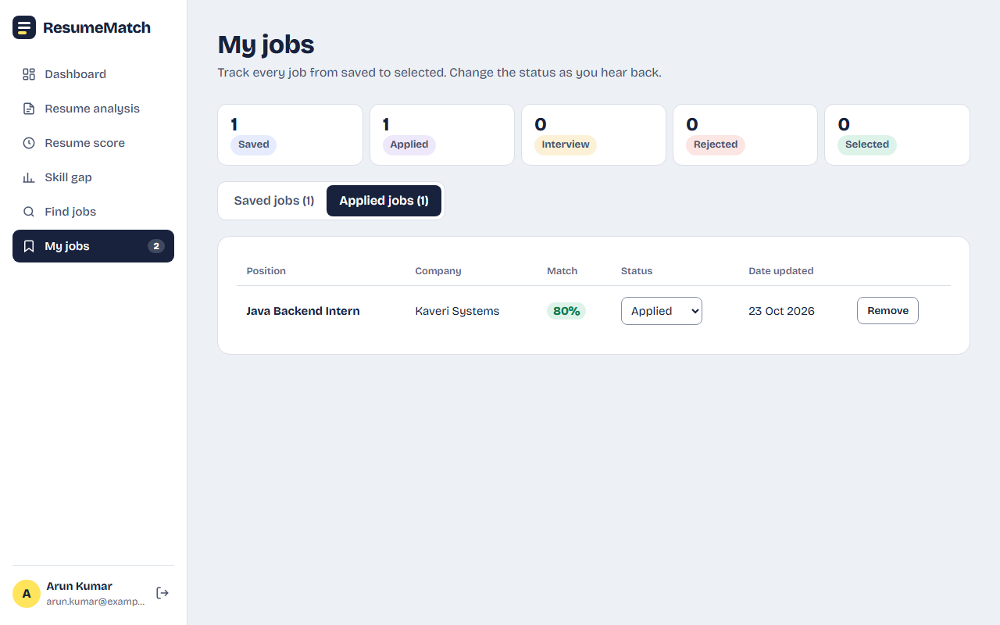
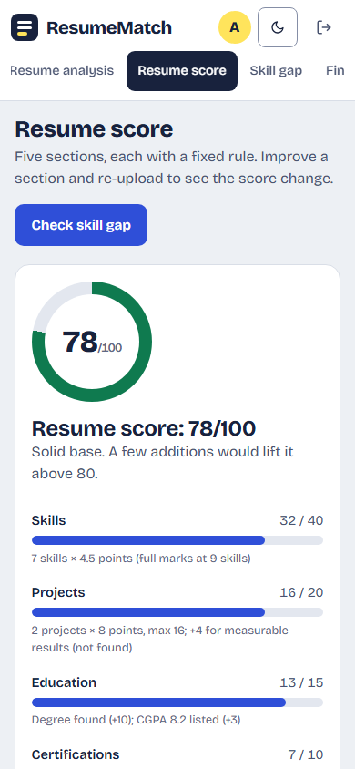
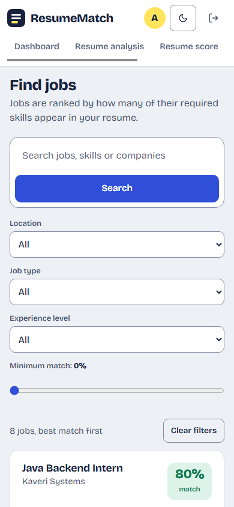

<div align="center">

# ResumeMatch

**Smart Resume Analyzer & Job Recommendation System**

Upload a resume, see which skills it shows, get a score out of 100 and find the jobs it already fits.

[](https://adoptium.net/)
[](https://tomcat.apache.org/download-90.cgi)
[](https://dev.mysql.com/downloads/mysql/)
[](LICENSE)
[](https://github.com/Barathkumar-17/ResumeMatch/actions/workflows/ci.yml)


</div>

## Contents
- [What it does](#what-it-does)
- [Features](#features)
- [Screenshots](#screenshots)
- [Quick start](#quick-start)
- [Setup](#setup)
- [Usage walkthrough](#usage-walkthrough)
- [How it works](#how-it-works)
- [Architecture](#architecture)
- [Project layout](#project-layout)
- [Configuration](#configuration)
- [Security](#security)
- [Testing](#testing)
- [Backup and restore](#backup-and-restore)
- [Troubleshooting](#troubleshooting)
- [Team](#team)
- [License](#license)

## What it does
A user uploads a resume (`.txt`, `.pdf` or `.docx`; older binary `.doc` files are not supported) (`.txt` up to 200 KB; `.pdf` and `.docx` up to 2 MB).
ResumeMatch extracts the skills it contains, scores the resume out of 100, shows the skills missing for a
target job, and ranks job openings by how many of their required skills the user already has.

Analysis is **rule-based**: skills are found by matching the resume text against a fixed skill
dictionary stored in the database. There is no AI or machine learning, so every number on screen can be
explained by a rule shown next to it.

## Features
- Register and log in (salted PBKDF2 password hashes, session-based access control, sign-in attempt limit)
- Upload a resume as `.txt`, `.pdf` or `.docx` (`.txt` up to 200 KB; `.pdf` and `.docx` up to 2 MB) with type, size, encoding and empty-file validation
- Skill extraction, grouped by category, with the skills highlighted in the resume text
- Five-part resume score (skills, projects, education, certifications, experience) with the reason for every rule
- Job search with keyword, location, type and experience filters and a minimum-match slider
- Job detail page that shows the match calculation, e.g. 4 of 5 required skills = 80%
- Skill gap analysis against a chosen job, with the skills most worth learning next
- Save jobs, mark them as applied and track status (Applied, Interview, Rejected, Selected)
- Light and dark theme, phone-width layout, keyboard accessible

Built with Java 17 · OOP · JDBC · MySQL 8 · Java file handling · Collections · exception handling ·
Servlets and JSP (Tomcat 9, `javax.servlet`) · HTML · CSS · JavaScript.
No frameworks, no ORM and no build tool: the project compiles with plain `javac`. The only jars are
MySQL Connector/J and Tomcat's servlet API. Fonts (Bricolage Grotesque and Source Serif 4, SIL Open Font
License) are bundled, so pages work offline.

## Screenshots
| | |
|---|---|
| [](screenshots/01-landing.png)<br>Landing page | [](screenshots/02-dashboard.png)<br>Dashboard after an upload |
| [](screenshots/03-analysis.png)<br>Resume analysis with highlighted skills | [](screenshots/04-score.png)<br>Resume score, rule by rule |
| [](screenshots/05-skill-gap.png)<br>Skill gap and what to learn next | [](screenshots/06-job-search.png)<br>Job search, best match first |
| [](screenshots/07-job-detail.png)<br>Job detail with the 80% calculation | [](screenshots/08-my-jobs.png)<br>My jobs: saved and applied |
| [](screenshots/09-score-dark.png)<br>Dark theme |  <br>Phone layout |

## Quick start
The shortest path to a running demo, on a machine that already has a JDK 17+, MySQL 8 and Tomcat 9:

```
git clone https://github.com/Barathkumar-17/ResumeMatch.git
cd ResumeMatch
# put mysql-connector-j-<version>.jar and servlet-api.jar in lib/ (see Setup, step 1)
mysql -u root -p < database/01_schema.sql
mysql -u root -p < database/02_seed_data.sql
cp src/main/resources/db.properties.example src/main/resources/db.properties   # then set db.user and db.password
./build.sh deploy                                                               # Windows: build.bat deploy
```
Open http://localhost:8080/ResumeMatch/ and log in with `demo@resumematch.in` / `demo1234`.
Details for every step are in [Setup](#setup).

## Setup
### Prerequisites
| Tool | Version | Needed for |
|---|---|---|
| JDK | 17 or newer | building and running |
| MySQL | 8.x | the database |
| Apache Tomcat | 9.x (`javax.servlet`) | running the web app |
| MySQL Connector/J | `mysql-connector-j-<version>.jar` | the JDBC driver |
| bash + curl, or PowerShell 5.1 | any | the smoke test (optional) |

### Steps
1. **Jars.** Put `mysql-connector-j-<version>.jar` (from https://dev.mysql.com/downloads/connector/j/,
   *Platform Independent*) and Tomcat's `servlet-api.jar` (from `<tomcat>/lib/`) into `lib/`.
   Copy the MySQL jar into `<tomcat>/lib/` as well and restart Tomcat once. The jars are not committed.
2. **Database.** Run the two scripts in order:
   ```
   mysql -u root -p < database/01_schema.sql
   mysql -u root -p < database/02_seed_data.sql
   ```
   This creates the `resumematch` database with 18 skills, 8 jobs and a demo user. Both scripts can be
   run again: the schema script drops and recreates the database, and the seed script clears the
   seeded tables before inserting. **Running either again deletes all accounts and resumes.**
3. **Connection settings.** Copy `src/main/resources/db.properties.example` to
   `src/main/resources/db.properties` and set `db.user` and `db.password`. This file is not committed.
4. **Build.** `build.bat` on Windows, `./build.sh` elsewhere. This produces `build/ResumeMatch.war`.
5. **Deploy.** `build.bat deploy` (or `./build.sh deploy`) builds the war and copies it into
   `%CATALINA_HOME%\webapps` (default `C:\Program Files\Apache Software Foundation\Tomcat 9.0`).
   Tomcat notices the new war and redeploys it by itself; the script never stops or starts Tomcat
   or any other service.
6. **Open** http://localhost:8080/ResumeMatch/

## Usage walkthrough
Log in with `demo@resumematch.in` / `demo1234`, or register a new account, then follow this script.

1. **Dashboard:** upload `sample-data/arun_kumar_resume.txt`. Uploading an unsupported type, an empty
   file or a file over the size limit shows a message and saves nothing.
2. **Analysis:** 7 skills are found (Java, SQL, JDBC, Git, DSA, C++, Python) and highlighted in the text.
3. **Score:** the resume scores **78/100**; every one of the five rules shows why it earned its points.
4. **Jobs:** search "Java". Four jobs are listed best match first: 80%, 75%, 40%, 33%.
5. **Job detail:** the Java Backend Intern job shows `4 of 5 required skills = 80%`, with Spring Boot missing.
6. **Skill gap:** for the same job the skill match is 67% (Spring Boot and REST API missing) and the
   page suggests what to learn next.
7. **My jobs:** save a job, mark it applied, change its status and remove it.
8. **Security:** sign out, then enter a wrong password five times for one email; the sixth try is
   refused with a "please wait" message.

### Run the analysis without a server
```
javac --release 17 -cp "lib/*" -d build/classes $(find src/main/java -name '*.java')
java -cp "build/classes:src/main/resources:lib/*" com.resumematch.console.ConsoleDemo
```
(On Windows use `;` instead of `:` in the classpath.) It prints the extracted skills, the score
breakdown and the ranked job list for `sample-data/arun_kumar_resume.txt`.

## How it works
Everything is deterministic and rule-based.

**Sections.** The resume is read line by line. A line in capitals such as `EDUCATION`, `SKILLS`,
`PROJECTS`, `CERTIFICATIONS` or `EXPERIENCE` (a few alternatives such as `INTERNSHIPS` are accepted)
starts a section. Lines starting with `-`, `•` or `*` are counted as bullet items.

**Skill detection.** Every skill in the dictionary (name plus aliases) is searched for in the whole
text, ignoring case. A match must not sit inside a longer word, and `+` and `#` count as word
characters, so `C++` is found and `Java` does not match `JavaScript`. A skill counts once however
often it appears.

**Resume score (100 points).** `s` is the number of skills, `p` the project bullets, `c` the
certification bullets and `e` the experience bullets.

| Rule | Points | Calculation |
|---|---|---|
| Skills | 40 | `min(40, round(s × 4.5))`, full marks at 9 skills |
| Projects | 20 | `min(16, p × 8)`, plus 4 if the projects or experience mention measurable results (a number with `%`, users, records, requests, ms and similar) |
| Education | 15 | 10 for a degree (B.E., B.Tech, M.Tech, B.Sc, BCA, MCA ...), plus 5 for a CGPA of 8.5 or more or 3 for a lower listed CGPA |
| Certifications | 10 | `min(10, round(c × 3.5))` |
| Experience | 15 | `min(15, e × 10)` |

For the sample resume: 32 + 16 + 13 + 7 + 10 = **78/100**. The score page also lists strengths and areas to improve.

**Job match.** Only required skills count; preferred skills never change the score.
```
match % = round(required skills the resume has × 100 / required skills of the job)
```
Jobs are sorted by match, then by title. Sample resume against the Java Backend Intern job:
4 of 5 required skills = **80%**.

**Skill gap.** The gap page counts required plus preferred skills, so the same job shows
4 of 6 = **67%**; the job match counts required skills only (80%) and the page says so. The
recommended skills are the required skills missing across all jobs, weighted by how close the
resume already is to each job, top five shown.

## Architecture
```
Browser  ->  Filters (security headers, CSRF, login)  ->  Servlet (web)  ->  Service (service)  ->  DAO (dao)  ->  MySQL
                                                              |
                                                         JSP views (display only)
```
- `model`: plain objects passed between layers (`User`, `Resume`, `Skill`, `Job`, `JobMatch`, ...)
- `exception`: custom exceptions with user-friendly messages; no stack trace ever reaches the browser
- `util`: JDBC connection, password hashing, sign-in attempt limit, input validation, HTML escaping
- `dao`: all SQL, using `PreparedStatement` only; the resume save is one transaction
- `service`: file reading and storage, resume analysis, scoring and job matching
  (`JobMatcher` interface with `SkillBasedJobMatcher` implementation)
- `web`: servlets, filters and the startup listener that sets up logging
- `console`: `ConsoleDemo`, which runs the whole analysis pipeline without a server

### Project layout
```
database/          01_schema.sql, 02_seed_data.sql
sample-data/       two sample resumes
screenshots/       images used in this README
src/main/java/     com.resumematch.{model,exception,util,dao,service,web,console}
src/main/webapp/   JSP views, CSS, JavaScript and fonts
test/              plain-Java unit tests (TestRunner)
scripts/           end-to-end smoke tests (bash and PowerShell)
lib/               MySQL Connector/J and servlet-api jars (not committed)
build.sh           build, test and deploy script for Linux/macOS/Git Bash
build.bat          the same for Windows
```

## Configuration
| Setting | Where | Default |
|---|---|---|
| Database URL, user, password | `db.properties` keys `db.url`, `db.user`, `db.password`, or the environment variables `RESUMEMATCH_DB_URL`, `RESUMEMATCH_DB_USER`, `RESUMEMATCH_DB_PASSWORD` (these win) | `jdbc:mysql://localhost:3306/resumematch`, `root`, empty |
| Database timeouts | added to the URL automatically unless it already sets them | connect 5 s, socket 30 s |
| Resume folder | context parameter `resumeDir` in `WEB-INF/web.xml` | `<tomcat>/resumes/user_<id>/` |
| Application log | `java.util.logging`, set up at startup | `<tomcat>/logs/resumematch.0.log` (1 MB × 5 files, rotated) |
| Session timeout | `WEB-INF/web.xml` | 30 minutes |

To use another resume folder, add this to `WEB-INF/web.xml`:
```xml
<context-param>
  <param-name>resumeDir</param-name>
  <param-value>C:/resumematch-uploads</param-value>
</context-param>
```

## Security
- **Passwords** are stored as salted PBKDF2 hashes (`PBKDF2WithHmacSHA256`, 210,000 iterations,
  16-byte random salt) in the form `pbkdf2$210000$<salt>$<hash>`. Accounts created by older versions
  (unsalted SHA-256) can still log in, and their hash is upgraded to PBKDF2 on that login.
- **Sign-in limit:** after 5 failed attempts for one email, or 30 from one IP address, within
  15 minutes, sign-in is refused until the window ends. The counters are kept in memory and reset
  when Tomcat restarts.
- **CSRF:** every form carries a random per-session token (`_csrf`) that is checked on every POST.
  A missing or wrong token gets a friendly 403 page.
- **Session cookie** is `HttpOnly` and `SameSite=Lax`, sessions end after 30 idle minutes, and a new
  session is started at login.
- **Response headers:** `Content-Security-Policy` (scripts, styles and fonts from the app only),
  `X-Frame-Options: DENY`, `X-Content-Type-Options: nosniff`, `Referrer-Policy: same-origin`.
  Private pages are sent with `Cache-Control: no-store`.
- **Request limits:** request bodies over 1 MB are refused (413), except the resume upload, which allows 3 MB. Resumes must be `.txt`, `.pdf` or
  `.docx` (`.txt` up to 200 KB; `.pdf` and `.docx` up to 2 MB) and not empty; text files must be valid UTF-8 without NUL bytes. Name,
  email and password lengths are limited.
- **Uploads** are saved under a generated file name inside the user's own folder; the submitted name
  is only displayed. Paths are checked to stay inside the resume folder, and users can only download
  their own resumes.
- **Errors:** users only see friendly messages; details go to the application log.
- **SQL:** every query is a `PreparedStatement` in a DAO class.
- **HTTPS** is not set up by the app itself. When it is put online, run it behind a host or proxy
  that provides HTTPS. The sign-in limit uses the address Tomcat sees, so behind a
  proxy configure Tomcat's `RemoteIpValve` to read the real client address.

## Testing
**Unit tests** (plain Java, no extra libraries, no database needed):
```
./build.sh test          # or: build.bat test
```
`test/com/resumematch/TestRunner.java` checks the analyzer, scorer, job matcher, validation,
password hashing, sign-in limit, HTML escaping and file service. Among other things it asserts that the sample
resume scores 78/100 with 7 skills, job 101 matches 80% and the skill gap for it is 67%. It exits
with status 1 on any failure. `./build.sh test deploy` deploys only when the tests pass.

**End-to-end smoke test** against a running server:
```
MYSQL_PWD=<mysql root password> scripts/smoke-test.sh http://localhost:8080/ResumeMatch
```
```
$env:MYSQL_PWD = "<mysql root password>"; .\scripts\smoke-test.ps1 -BaseUrl http://localhost:8080/ResumeMatch
```
It registers a throw-away `smoke-<timestamp>@example.com` user, walks through every page and flow
(including an unsupported file type, an empty file, an oversized file and a `../` file name), checks the
security headers, CSRF and the friendly error pages, and then deletes that user's resume files and
database rows, even when a check fails. The clean-up uses the `mysql` client; `MYSQL` (client path),
`MYSQL_USER` and `MYSQL_DB` can be set as well.

**Continuous integration.** The workflow `.github/workflows/ci.yml` (the CI badge at the top) runs
the build and checks on GitHub for every push.

## Backup and restore
Back up the database and the resume folder together, because each resume row points to a file:
```
mysqldump -u root -p --single-transaction resumematch > resumematch-backup.sql
```
and copy `<tomcat>/resumes/`. To restore:
```
mysql -u root -p -e "CREATE DATABASE IF NOT EXISTS resumematch CHARACTER SET utf8mb4 COLLATE utf8mb4_unicode_ci"
mysql -u root -p resumematch < resumematch-backup.sql
```
then put the resume folder back in the same place.

## Troubleshooting
| Problem | Fix |
|---|---|
| `ClassNotFoundException: com.mysql.cj.jdbc.Driver` in the log | The MySQL jar is missing from `<tomcat>/lib/`. Copy it there and restart Tomcat. |
| "Can't reach the database right now" | MySQL is not running, or `db.user` / `db.password` are wrong. Check `<tomcat>/logs/resumematch.0.log`, fix `db.properties` and rebuild. |
| `Access denied for user 'root'` in the log | The password in `db.properties` does not match your MySQL password. |
| "This form expired" (403) after submitting a form | The session timed out or the page was open in an old tab. Reload the page and submit again. |
| "Too many failed sign-in attempts" | Wait for the time shown, or restart Tomcat to clear the in-memory counters. |
| Build says `servlet-api.jar is missing` | Copy `servlet-api.jar` from `<tomcat>/lib/` into `lib/`. |
| `build.sh` fails with `$'\r': command not found` | The script was checked out with Windows line endings. Run `git add --renormalize . && git checkout -- build.sh`. |
| Port 8080 already in use | Stop the other program, or change the connector port in `<tomcat>/conf/server.xml`. |
| `package javax.servlet does not exist` or `jakarta` errors | This project targets Tomcat 9 (`javax.servlet`). Tomcat 10 and later use `jakarta.servlet`. |
| Upload fails or downloads return 404 | Make sure Tomcat can write to `<tomcat>/resumes/`, or set the `resumeDir` parameter shown above. |
| Dates are a few hours off | Remove any `serverTimezone` setting from `db.url`; the driver detects the server time zone itself. |
| Smoke test cannot clean up | Put the `mysql` client on the PATH (or set `MYSQL`) and set `MYSQL_PWD`. |

## Team
| Member | Area |
|---|---|
| Barathkumar M P | Database, analysis engine, authentication, upload and analysis pages, build, packaging and deployment |
| Gokul K | Models, exceptions, JDBC data access, password hashing and sign-in limit |
| Hemanth Suresh | Page shell: stylesheet, scripts, landing and login pages, security filters |
| Faseesh | Resume score page, resume download, accessibility and mobile layout |
| Rithik | Job search, job detail and skill gap, logging and upload checks |
| Rishi | Saved jobs and application tracking, unit and smoke tests |

## License
Released under the [MIT License](LICENSE). Copyright (c) 2026 the ResumeMatch team.
