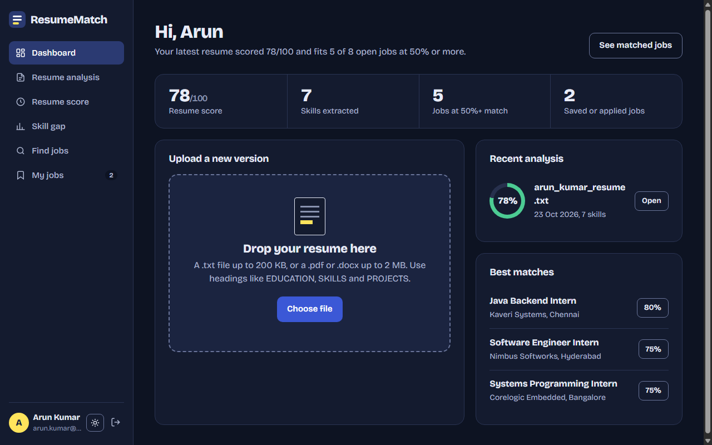

<div align="center">

# ResumeMatch

**Smart Resume Analyzer & Job Recommendation System**

Upload a resume, see which skills it shows, get a score out of 100 and find the jobs it already fits.

[](https://adoptium.net/)
[](https://tomcat.apache.org/download-90.cgi)
[](https://dev.mysql.com/downloads/mysql/)
[](LICENSE)
[](https://github.com/Barathkumar-17/ResumeMatch/actions/workflows/ci.yml)



</div>

## Contents
- [What it does](#what-it-does)
- [Demo run](#demo-run)
- [Quick start for beginners](#quick-start-for-beginners)
- [Features](#features)
- [How it works](#how-it-works)
- [Code tour: where to look](#code-tour-where-to-look)
- [Architecture](#architecture)
- [Project layout](#project-layout)
- [Setup and configuration](#setup-and-configuration)
- [Security](#security)
- [Testing](#testing)
- [Backup and restore](#backup-and-restore)
- [Troubleshooting](#troubleshooting)
- [Team](#team)
- [License](#license)
- [More screenshots](SCREENSHOTS.md)

## What it does
You upload a resume. ResumeMatch then:

1. finds the **skills** written in it (Java, SQL, Git and so on),
2. gives the resume a **score out of 100** and shows the reason for every point,
3. shows the **skills you are missing** for a job you pick,
4. **ranks job openings** by how many of their required skills you already have.

Resumes can be `.txt` (up to 200 KB), `.pdf` or `.docx` (up to 2 MB each). Older binary `.doc` files are
not supported, and a password-protected or scanned PDF gets a friendly message instead of a result.

> **Note:** the analysis is **rule-based**. Skills are found by matching the resume text against a fixed
> skill dictionary stored in the database. There is no AI or machine learning, so every number on screen
> can be explained by a rule shown next to it.

## Demo run
New here? [DEMO.md](DEMO.md) is a guided tour of about ten minutes. Every step has a screenshot and the
exact numbers you should see: create an account, upload a resume (78/100), read the skill gap (67%),
search jobs (80, 75, 40, 33), save and apply, then try dark mode and the phone layout.

One command sets everything up. It checks your tools, creates `db.properties`, runs the unit tests, builds
and deploys the app, and waits until the site answers. It never starts or stops Tomcat or MySQL.
```
scripts/demo-setup.sh --reset-db          # Linux, macOS, Git Bash
.\scripts\demo-setup.ps1 -ResetDb         # Windows PowerShell
```
Run it without the flag to just rebuild and redeploy. Then log in with `demo@resumematch.in` / `demo1234`.

More screens: [SCREENSHOTS.md](SCREENSHOTS.md).

> **Warning:** `--reset-db` / `-ResetDb` reloads the database and **deletes all accounts and resumes**,
> so the script asks for confirmation first.

## Quick start for beginners
Never set up a Java web app before? Follow these steps in order. Each one says what it does and how to
check that it worked. (Want it done for you? Use the [demo setup script](#demo-run).)

1. **Install the tools.** You need three things:
   - **JDK 17 or newer** (the Java compiler and runtime). Get it from https://adoptium.net/.
   - **MySQL 8** (the database). Get it from https://dev.mysql.com/downloads/mysql/.
   - **Apache Tomcat 9** (the web server that runs the app). Get it from https://tomcat.apache.org/download-90.cgi.
     Use version 9, not 10: this project uses `javax.servlet`.

   *Check:* `java -version` prints 17 or higher, and `mysql --version` prints 8.x.

2. **Get the code.**
   ```
   git clone https://github.com/Barathkumar-17/ResumeMatch.git
   cd ResumeMatch
   ```
3. **Get the two jars** and put both in the `lib/` folder (create it if it is missing). A jar is a
   packaged Java library. The project needs only these two:
   - `mysql-connector-j-<version>.jar` from https://dev.mysql.com/downloads/connector/j/
     (choose *Platform Independent*). It lets Java talk to MySQL.
   - `servlet-api.jar`, found in `<tomcat>/lib/`. It lets the code compile against Tomcat.

   Also copy the MySQL jar into `<tomcat>/lib/` and restart Tomcat once. The jars are not committed.

   *Check:* `lib/` holds exactly two `.jar` files.

4. **Load the database.** These two scripts create the `resumematch` database, 18 skills, 8 jobs and a
   demo user:
   ```
   mysql -u root -p < database/01_schema.sql
   mysql -u root -p < database/02_seed_data.sql
   ```
   *Check:* `mysql -u root -p -e "SELECT COUNT(*) FROM resumematch.jobs"` prints 8.

5. **Tell the app how to reach the database.** Copy the example settings file, then open the copy and set
   `db.user` and `db.password` to your MySQL login:
   ```
   cp src/main/resources/db.properties.example src/main/resources/db.properties
   ```
   (On Windows PowerShell use `copy` instead of `cp`.) This file stays on your machine and is not committed.

6. **Build and deploy.** This compiles the code, packs `build/ResumeMatch.war` and copies it into Tomcat's
   `webapps` folder. Tomcat notices the new file and starts the app by itself.
   ```
   ./build.sh deploy          # Windows: build.bat deploy
   ```
   *Check:* the script ends without errors and `webapps/ResumeMatch/` appears in Tomcat after a few seconds.

7. **Open the app.** Go to http://localhost:8080/ResumeMatch/ and log in with `demo@resumematch.in` /
   `demo1234`, or register your own account. Upload `sample-data/arun_kumar_resume.txt`.

   *Check:* the dashboard shows **78/100** and **7 skills**.

> **Tip:** if something goes wrong, the [Troubleshooting](#troubleshooting) table lists the common
> messages and their fixes. The app log is `<tomcat>/logs/resumematch.0.log`.

## Features
- Register and log in (salted PBKDF2 password hashes, session-based access control, sign-in attempt limit)
- Upload a resume as `.txt`, `.pdf` or `.docx` (`.txt` up to 200 KB; `.pdf` and `.docx` up to 2 MB) with type, size, encoding and empty-file validation (old `.doc`, encrypted and scanned PDFs are refused with a clear message)
- Skill extraction, grouped by category, with the skills highlighted in the resume text
- Five-part resume score (skills, projects, education, certifications, experience) with the reason for every rule
- Job search with keyword, location, type and experience filters and a minimum-match slider
- Job detail page that shows the match calculation, e.g. 4 of 5 required skills = 80%
- Skill gap analysis against a chosen job, with the skills most worth learning next
- Save jobs, mark them as applied (the job then shows "Applied") and track status (Applied, Interview, Rejected, Selected)
- Light and dark theme, phone-width layout, keyboard accessible

Built with Java 17 · OOP · JDBC · MySQL 8 · Java file handling · Collections · exception handling ·
Servlets and JSP (Tomcat 9, `javax.servlet`) · HTML · CSS · JavaScript.
No frameworks, no ORM and no build tool: the project compiles with plain `javac`. The only jars are
MySQL Connector/J and Tomcat's servlet API. Fonts (Bricolage Grotesque and Source Serif 4, SIL Open Font
License) are bundled, so pages work offline.

## How it works
Everything is deterministic and rule-based: the same resume always gives the same result.

**Sections.** The resume is read line by line. A line that holds only a heading such as `EDUCATION` (any letter case, optional colon), `SKILLS`,
`PROJECTS`, `CERTIFICATIONS` or `EXPERIENCE` (a few alternatives such as `INTERNSHIPS` are accepted)
starts a section. Lines starting with `-`, `•` or `*` are the items; a section without any such line uses its non-empty lines.

**Skill detection.** Every skill in the dictionary (name plus aliases) is searched for in the whole
text, ignoring case. A match must not sit inside a longer word, and `+` and `#` count as word
characters, so `C++` is found and `Java` does not match `JavaScript`. A skill counts once however
often it appears.

**Resume score (100 points).** `s` is the number of skills, `p` the project bullets, `c` the
certification bullets and `e` the experience bullets.

| Rule | Points | Calculation |
|---|---|---|
| Skills | 40 | `min(40, round(s × 4.5))`, full marks at 9 skills |
| Projects | 20 | `min(16, p × 8)`, plus 4 if the projects or experience mention measurable results (a number with `%`, users, records, requests, ms and similar) |
| Education | 15 | 10 for a degree (B.E., B.Tech, M.Tech, B.Sc, BCA, MCA ...), plus 5 for a CGPA of 8.5 or more or 3 for a lower listed CGPA |
| Certifications | 10 | `min(10, round(c × 3.5))` |
| Experience | 15 | `min(15, e × 10)` |

**Worked example.** The sample resume `sample-data/arun_kumar_resume.txt` earns
32 (skills) + 16 (projects) + 13 (education) + 7 (certifications) + 10 (experience) = **78/100**.
The score page also lists strengths and areas to improve.

**Job match.** Only required skills count; preferred skills never change the score.
```
match % = round(required skills the resume has × 100 / required skills of the job)
```
Jobs are sorted by match, then by title. The sample resume against the Java Backend Intern job has
4 of its 5 required skills, so 4 ÷ 5 × 100 = **80%**.

**Skill gap.** The gap page counts required plus preferred skills, so the same job shows
4 of 6 = **67%**. The job match counts required skills only (80%) and the page says so. The
recommended skills are the required skills missing across all jobs, weighted by how close the
resume already is to each job, top five shown.

**Run the analysis without a server.** This prints the skills, the score breakdown and the ranked job
list for the sample resume (it needs the database for the skill dictionary and jobs):
```
javac --release 17 -cp "lib/*" -d build/classes $(find src/main/java -name '*.java')
java -cp "build/classes:src/main/resources:lib/*" com.resumematch.console.ConsoleDemo
```
(On Windows use `;` instead of `:` in the classpath.)

## Code tour: where to look
All Java code is under [`src/main/java/com/resumematch/`](src/main/java/com/resumematch). Every class starts with a
short comment ending in "Demonstrates: ...", so you can also search for that word.

| Topic | Where to look | What to see there |
|---|---|---|
| **OOP: interfaces and polymorphism** | [`ResumeReader`](src/main/java/com/resumematch/service/ResumeReader.java) with [`TxtResumeReader`](src/main/java/com/resumematch/service/TxtResumeReader.java), [`PdfResumeReader`](src/main/java/com/resumematch/service/PdfResumeReader.java), [`DocxResumeReader`](src/main/java/com/resumematch/service/DocxResumeReader.java); [`JobMatcher`](src/main/java/com/resumematch/service/JobMatcher.java) with [`SkillBasedJobMatcher`](src/main/java/com/resumematch/service/SkillBasedJobMatcher.java) | One interface, several implementations; callers use the interface only |
| **OOP: encapsulation and composition** | [`model/`](src/main/java/com/resumematch/model): [`User`](src/main/java/com/resumematch/model/User.java), [`Resume`](src/main/java/com/resumematch/model/Resume.java), [`Job`](src/main/java/com/resumematch/model/Job.java), [`JobMatch`](src/main/java/com/resumematch/model/JobMatch.java), [`ScoreBreakdown`](src/main/java/com/resumematch/model/ScoreBreakdown.java) | Private fields with getters and setters; a `Resume` has a `ResumeInfo`, a `JobMatch` has a `Job` |
| **OOP: enum** | [`ResumeFileType`](src/main/java/com/resumematch/service/ResumeFileType.java) | Enum with fields, constructor and per-type behaviour (extension, size limit, byte check) |
| **Collections** | [`ResumeAnalyzer`](src/main/java/com/resumematch/service/ResumeAnalyzer.java) (`HashMap` skill dictionary, `HashSet` of found skills); [`FileService`](src/main/java/com/resumematch/service/FileService.java) (`EnumMap` of readers); [`JobDAO`](src/main/java/com/resumematch/dao/JobDAO.java) (`LinkedHashMap` keeps query order); [`JobSearchServlet`](src/main/java/com/resumematch/web/JobSearchServlet.java) (`TreeSet` for sorted filter lists); [`SkillBasedJobMatcher`](src/main/java/com/resumematch/service/SkillBasedJobMatcher.java) (`Comparator` ranking); [`LoginAttemptLimiter`](src/main/java/com/resumematch/util/LoginAttemptLimiter.java) (`ConcurrentHashMap`) | Choosing the right collection for the job |
| **Exception handling** | [`exception/`](src/main/java/com/resumematch/exception): abstract [`AppException`](src/main/java/com/resumematch/exception/AppException.java) with [`InvalidFileException`](src/main/java/com/resumematch/exception/InvalidFileException.java), [`EmptyResumeException`](src/main/java/com/resumematch/exception/EmptyResumeException.java), [`FileReadException`](src/main/java/com/resumematch/exception/FileReadException.java), [`DatabaseConnectionException`](src/main/java/com/resumematch/exception/DatabaseConnectionException.java), [`DuplicateEmailException`](src/main/java/com/resumematch/exception/DuplicateEmailException.java), [`InvalidLoginException`](src/main/java/com/resumematch/exception/InvalidLoginException.java), [`InvalidJobException`](src/main/java/com/resumematch/exception/InvalidJobException.java), [`MissingFieldException`](src/main/java/com/resumematch/exception/MissingFieldException.java) | A custom checked-exception hierarchy with friendly messages and exception chaining; servlets turn them into on-page messages, never a stack trace |
| **File handling** | [`FileService`](src/main/java/com/resumematch/service/FileService.java) (save, read, path checks), [`TxtResumeReader`](src/main/java/com/resumematch/service/TxtResumeReader.java), [`PdfResumeReader`](src/main/java/com/resumematch/service/PdfResumeReader.java), [`DocxResumeReader`](src/main/java/com/resumematch/service/DocxResumeReader.java); [`ResumeUploadServlet`](src/main/java/com/resumematch/web/ResumeUploadServlet.java), [`ResumeDownloadServlet`](src/main/java/com/resumematch/web/ResumeDownloadServlet.java) | `java.nio.file`, buffered reading, ZIP and XML (`.docx`) and PDF parsing with only the JDK |
| **JDBC** | [`dao/`](src/main/java/com/resumematch/dao): [`UserDAO`](src/main/java/com/resumematch/dao/UserDAO.java), [`ResumeDAO`](src/main/java/com/resumematch/dao/ResumeDAO.java), [`JobDAO`](src/main/java/com/resumematch/dao/JobDAO.java), [`SkillDAO`](src/main/java/com/resumematch/dao/SkillDAO.java), [`ApplicationDAO`](src/main/java/com/resumematch/dao/ApplicationDAO.java); connection in [`DatabaseConnection`](src/main/java/com/resumematch/util/DatabaseConnection.java) | `PreparedStatement` everywhere, try-with-resources; `ResumeDAO` saves a resume in one transaction (commit and rollback) with batch inserts |
| **Servlets and JSP** | [`web/`](src/main/java/com/resumematch/web) servlets, for example [`LoginServlet`](src/main/java/com/resumematch/web/LoginServlet.java), [`ScoreServlet`](src/main/java/com/resumematch/web/ScoreServlet.java), [`JobSearchServlet`](src/main/java/com/resumematch/web/JobSearchServlet.java); pages in [`WEB-INF/views/`](src/main/webapp/WEB-INF/views); settings in [`web.xml`](src/main/webapp/WEB-INF/web.xml) | Servlets prepare the data and forward to a JSP; JSPs only display it (plain EL, no logic) |
| **Filters and security** | [`SecurityHeadersFilter`](src/main/java/com/resumematch/web/SecurityHeadersFilter.java), [`CsrfFilter`](src/main/java/com/resumematch/web/CsrfFilter.java), [`AuthFilter`](src/main/java/com/resumematch/web/AuthFilter.java), [`LoginAttemptLimiter`](src/main/java/com/resumematch/util/LoginAttemptLimiter.java), [`PasswordUtil`](src/main/java/com/resumematch/util/PasswordUtil.java), [`ValidationUtil`](src/main/java/com/resumematch/util/ValidationUtil.java), [`HtmlUtil`](src/main/java/com/resumematch/util/HtmlUtil.java) | Headers, CSRF tokens, login check, brute-force limit, PBKDF2 hashing, input validation, HTML escaping (see [Security](#security)) |
| **Logging** | [`AppStartupListener`](src/main/java/com/resumematch/web/AppStartupListener.java) | `ServletContextListener` that sets up `java.util.logging` with a rotating file |
| **Business rules** | [`ResumeAnalyzer`](src/main/java/com/resumematch/service/ResumeAnalyzer.java) (skills), [`ResumeScorer`](src/main/java/com/resumematch/service/ResumeScorer.java) (score), [`SkillBasedJobMatcher`](src/main/java/com/resumematch/service/SkillBasedJobMatcher.java) (match and gap) | The rules described in [How it works](#how-it-works), with no web or SQL code |
| **Testing** | [`TestRunner`](test/com/resumematch/TestRunner.java), [`DocumentReaderTests`](test/com/resumematch/DocumentReaderTests.java), [`SecurityTests`](test/com/resumematch/SecurityTests.java); [`smoke-test.sh`](scripts/smoke-test.sh) / [`smoke-test.ps1`](scripts/smoke-test.ps1); [`ci.yml`](.github/workflows/ci.yml) | Plain-Java tests with no framework, an end-to-end script and the CI workflow (see [Testing](#testing)) |

> **Tip:** to follow one request from start to finish, open
> [`ResumeUploadServlet`](src/main/java/com/resumematch/web/ResumeUploadServlet.java), then
> [`FileService`](src/main/java/com/resumematch/service/FileService.java),
> [`ResumeAnalyzer`](src/main/java/com/resumematch/service/ResumeAnalyzer.java),
> [`ResumeScorer`](src/main/java/com/resumematch/service/ResumeScorer.java) and
> [`ResumeDAO`](src/main/java/com/resumematch/dao/ResumeDAO.java).

## Architecture
```
Browser  ->  Filters (security headers, CSRF, login)  ->  Servlet (web)  ->  Service (service)  ->  DAO (dao)  ->  MySQL
                                                              |
                                                         JSP views (display only)
```
- `model`: plain objects passed between layers (`User`, `Resume`, `Skill`, `Job`, `JobMatch`, ...)
- `exception`: custom exceptions with user-friendly messages; no stack trace ever reaches the browser
- `util`: JDBC connection, password hashing, sign-in attempt limit, input validation, HTML escaping
- `dao`: all SQL, using `PreparedStatement` only; the resume save is one transaction
- `service`: file reading and storage, resume analysis, scoring and job matching
  (`ResumeReader` and `JobMatcher` interfaces with their implementations)
- `web`: servlets, filters and the startup listener that sets up logging
- `console`: `ConsoleDemo`, which runs the whole analysis pipeline without a server

### Project layout
```
database/          01_schema.sql, 02_seed_data.sql
sample-data/       two sample resumes
screenshots/       images used in this README (demo/ holds the ones used by DEMO.md)
src/main/java/     com.resumematch.{model,exception,util,dao,service,web,console}
src/main/webapp/   JSP views (WEB-INF/views), CSS, JavaScript and fonts
test/              plain-Java unit tests (TestRunner)
scripts/           demo setup and end-to-end smoke tests (bash and PowerShell)
lib/               MySQL Connector/J and servlet-api jars (not committed)
DEMO.md            guided tour of the whole product
build.sh           build, test and deploy script for Linux/macOS/Git Bash
build.bat          the same for Windows
```

## Setup and configuration
The [beginner steps](#quick-start-for-beginners) above are all you need to get running. This section
adds the detail.

### Prerequisites
| Tool | Version | Needed for |
|---|---|---|
| JDK | 17 or newer | building and running |
| MySQL | 8.x | the database |
| Apache Tomcat | 9.x (`javax.servlet`) | running the web app |
| MySQL Connector/J | `mysql-connector-j-<version>.jar` | the JDBC driver |
| bash + curl, or PowerShell 5.1 | any | the smoke test (optional) |

### Notes on the steps
- **Database scripts can be run again.** The schema script drops and recreates the database, and the seed
  script clears the seeded tables before inserting. **Running either again deletes all accounts and resumes.**
- **Build.** `build.bat` on Windows, `./build.sh` elsewhere, produces `build/ResumeMatch.war`.
- **Deploy.** `build.bat deploy` (or `./build.sh deploy`) builds the war and copies it into
  `%CATALINA_HOME%\webapps` (default `C:\Program Files\Apache Software Foundation\Tomcat 9.0`).
  The script never stops or starts Tomcat or any other service.

### Configuration
| Setting | Where | Default |
|---|---|---|
| Database URL, user, password | `db.properties` keys `db.url`, `db.user`, `db.password`, or the environment variables `RESUMEMATCH_DB_URL`, `RESUMEMATCH_DB_USER`, `RESUMEMATCH_DB_PASSWORD` (these win) | `jdbc:mysql://localhost:3306/resumematch`, `root`, empty |
| Database timeouts | added to the URL automatically unless it already sets them | connect 5 s, socket 30 s |
| Resume folder | context parameter `resumeDir` in `WEB-INF/web.xml` | `<tomcat>/resumes/user_<id>/` |
| Application log | `java.util.logging`, set up at startup | `<tomcat>/logs/resumematch.0.log` (1 MB × 5 files, rotated) |
| Session timeout | `WEB-INF/web.xml` | 30 minutes |

To use another resume folder, add this to `WEB-INF/web.xml`:
```xml
<context-param>
  <param-name>resumeDir</param-name>
  <param-value>C:/resumematch-uploads</param-value>
</context-param>
```

## Security
- **Passwords** are stored as salted PBKDF2 hashes (`PBKDF2WithHmacSHA256`, 210,000 iterations,
  16-byte random salt) in the form `pbkdf2$210000$<salt>$<hash>`. Accounts created by older versions
  (unsalted SHA-256) can still log in, and their hash is upgraded to PBKDF2 on that login.
- **Sign-in limit:** after 5 failed attempts for one email, or 30 from one IP address, within
  15 minutes, sign-in is refused until the window ends. The counters are kept in memory and reset
  when Tomcat restarts.
- **CSRF:** every form carries a random per-session token (`_csrf`) that is checked on every POST.
  A missing or wrong token gets a friendly 403 page. Log out is a POST button too, so a link on another
  site cannot sign a user out.
- **Session cookie** is `HttpOnly` and `SameSite=Lax`, sessions end after 30 idle minutes, and a new
  session is started at login.
- **Response headers:** `Content-Security-Policy` (scripts, styles and fonts from the app only),
  `X-Frame-Options: DENY`, `X-Content-Type-Options: nosniff`, `Referrer-Policy: same-origin`.
  Private pages are sent with `Cache-Control: no-store`.
- **Request limits:** request bodies over 1 MB are refused (413), except the resume upload, which allows 3 MB. Resumes must be `.txt`, `.pdf` or
  `.docx` (`.txt` up to 200 KB; `.pdf` and `.docx` up to 2 MB) and not empty; text files must be valid UTF-8 without NUL bytes. Name,
  email and password lengths are limited.
- **Uploads** are saved under a generated file name inside the user's own folder; the submitted name
  is only displayed. Paths are checked to stay inside the resume folder, and users can only download
  their own resumes.
- **Errors:** users only see friendly messages; details go to the application log.
- **SQL:** every query is a `PreparedStatement` in a DAO class.
- **HTTPS** is not set up by the app itself. When it is put online, run it behind a host or proxy
  that provides HTTPS. The sign-in limit uses the address Tomcat sees, so behind a
  proxy configure Tomcat's `RemoteIpValve` to read the real client address.

## Testing
**Unit tests** (plain Java, no extra libraries, no database needed):
```
./build.sh test          # or: build.bat test
```
`test/com/resumematch/TestRunner.java` (with `DocumentReaderTests` and `SecurityTests`) checks the analyzer,
scorer, job matcher, validation, PDF and DOCX reading, password hashing, sign-in limit, HTML escaping and
file service. Among other things it asserts that the sample
resume scores 78/100 with 7 skills, job 101 matches 80% and the skill gap for it is 67%. It exits
with status 1 on any failure. `./build.sh test deploy` deploys only when the tests pass.

**End-to-end smoke test** against a running server:
```
MYSQL_PWD=<mysql root password> scripts/smoke-test.sh http://localhost:8080/ResumeMatch
```
```
$env:MYSQL_PWD = "<mysql root password>"; .\scripts\smoke-test.ps1 -BaseUrl http://localhost:8080/ResumeMatch
```
It registers a throw-away `smoke-<timestamp>@example.com` user, walks through every page and flow
(including an unsupported file type, an empty file, an oversized file and a `../` file name), checks the
security headers, CSRF and the friendly error pages, and then deletes that user's resume files and
database rows, even when a check fails. The clean-up uses the `mysql` client; `MYSQL` (client path),
`MYSQL_USER` and `MYSQL_DB` can be set as well.

**Continuous integration.** The workflow `.github/workflows/ci.yml` (the CI badge at the top) runs on GitHub
for pushes to `main` and for pull requests. It downloads the two jars, runs the unit tests and builds the war on
Linux and Windows, then deploys the war to a real Tomcat 9 with MySQL 8 and runs the smoke test.

## Backup and restore
Back up the database and the resume folder together, because each resume row points to a file:
```
mysqldump -u root -p --single-transaction resumematch > resumematch-backup.sql
```
and copy `<tomcat>/resumes/`. To restore:
```
mysql -u root -p -e "CREATE DATABASE IF NOT EXISTS resumematch CHARACTER SET utf8mb4 COLLATE utf8mb4_unicode_ci"
mysql -u root -p resumematch < resumematch-backup.sql
```
then put the resume folder back in the same place.

## Troubleshooting
| Problem | Fix |
|---|---|
| `ClassNotFoundException: com.mysql.cj.jdbc.Driver` in the log | The MySQL jar is missing from `<tomcat>/lib/`. Copy it there and restart Tomcat. |
| "Can't reach the database right now" | MySQL is not running, or `db.user` / `db.password` are wrong. Check `<tomcat>/logs/resumematch.0.log`, fix `db.properties` and rebuild. |
| `Access denied for user 'root'` in the log | The password in `db.properties` does not match your MySQL password. |
| "This form expired" (403) after submitting a form | The session timed out or the page was open in an old tab. Reload the page and submit again. |
| "Too many failed sign-in attempts" | Wait for the time shown, or restart Tomcat to clear the in-memory counters. |
| Build says `servlet-api.jar is missing` | Copy `servlet-api.jar` from `<tomcat>/lib/` into `lib/`. |
| `build.sh` fails with `$'\r': command not found` | The script was checked out with Windows line endings. Run `git add --renormalize . && git checkout -- build.sh`. |
| Port 8080 already in use | Stop the other program, or change the connector port in `<tomcat>/conf/server.xml`. |
| `package javax.servlet does not exist` or `jakarta` errors | This project targets Tomcat 9 (`javax.servlet`). Tomcat 10 and later use `jakarta.servlet`. |
| "password-protected" or "scanned image" message for a PDF | Text cannot be read from encrypted PDFs or scans. Export a text-based PDF, or upload a `.txt` or `.docx` copy. Old `.doc` files must be saved as `.docx` first. |
| Upload fails or downloads return 404 | Make sure Tomcat can write to `<tomcat>/resumes/`, or set the `resumeDir` parameter shown above. |
| Dates are a few hours off | Remove any `serverTimezone` setting from `db.url`; the driver detects the server time zone itself. |
| Smoke test cannot clean up | Put the `mysql` client on the PATH (or set `MYSQL`) and set `MYSQL_PWD`. |

## Team
| Member | Area |
|---|---|
| Barathkumar M P | Database, analysis engine, authentication, upload and analysis pages, build, packaging and deployment |
| Gokul K | Models, exceptions, JDBC data access, password hashing and sign-in limit |
| Hemanth Suresh | Page shell: stylesheet, scripts, landing and login pages, security filters |
| Faseesh | Resume score page, resume download, accessibility and mobile layout |
| Rithik | Job search, job detail and skill gap, logging and upload checks |
| Rishi | Saved jobs and application tracking, unit and smoke tests |

## License
Released under the [MIT License](LICENSE). Copyright (c) 2026 the ResumeMatch team.
